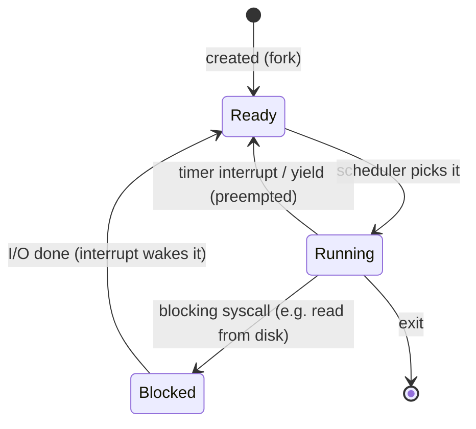

# 02 · Processes

> **In one line:** a process is the OS's abstraction of a running program — a memory image + live CPU context +
> I/O state — tracked by a kernel **PCB**, moving through **running / ready / blocked** states as the OS
> virtualizes the CPU across many of them.

Prereqs: [[00 - OS Introduction]], [[01 - Computer Architecture Background]].
Next: [[03 - Process System Calls]], [[04 - Trap Handling and Context Switching]].

---

## 1. The process abstraction

A **process = a running program.** When you launch a program the OS creates a process: allocates memory,
initializes CPU context, and starts it in user mode. From then on the user code runs directly on the CPU; the OS
only steps back in for **syscalls, interrupts, or faults** ([[00 - OS Introduction]] §6).

The process is *the* unit of the OS's **CPU virtualization**: each process is given the illusion it owns the CPU.

## 2. What defines a process?

| Part | What it is | Where it lives |
|---|---|---|
| **PID** | unique process identifier | kernel |
| **Memory image** | code + data (from the executable) + stack + heap | RAM (its virtual address space) |
| **CPU context** | PC, stack pointer, general-purpose registers | in CPU registers *while running*; saved in the PCB otherwise |
| **I/O state** | open files, network connections, current directory | kernel |

The key subtlety: when the process **runs**, its context *is* the CPU registers. When it's **paused**, that
context is copied into kernel memory (the PCB) so it can be restored later, bit-for-bit.

## 3. Process states

An active process is always in exactly one of these:



- **Running** — currently executing on a CPU core. Its context is in the registers.
- **Ready / runnable** — able to run, just waiting for the scheduler to pick it. Many can be ready at once; only
  one runs per core.
- **Blocked / sleeping / suspended** — *cannot* run yet because it's waiting for something (disk data, a lock, a
  network packet). The scheduler won't pick it until it's unblocked.

Contexts of ready and blocked processes are saved in OS memory so they can resume cleanly.

> [!warning] Ready vs Blocked is a classic confusion
> A **ready** process *could* run right now — nothing is stopping it but the scheduler. A **blocked** process
> *cannot* run even if the CPU is free, because the thing it's waiting for hasn't happened. Putting a process to
> sleep when it's waiting (instead of spinning) is what lets the CPU do useful work meanwhile.

## 4. Worked example: two processes, one disk read

Two processes P0 (running) and P1 (ready):

```
t0:  P0 running, P1 ready
t1:  P0 calls read() for a file  → syscall traps into OS
t2:  OS issues disk command; data not ready → P0 goes BLOCKED
t3:  OS schedules P1 → P1 RUNNING
t4:  disk finishes → raises INTERRUPT
t5:  CPU jumps to OS; OS marks P0 READY (not running yet!)
t6:  OS resumes P1 (or later switches to P0 when it decides to)
```

Notice: the interrupt makes P0 **ready**, not immediately running. The scheduler decides *when* P0 actually runs
again. This decoupling — "wake it up" vs "run it now" — is central.

## 5. The Process Control Block (PCB)

Everything the kernel knows about a process is in one data structure, the **PCB**:

- PID
- state (running / ready / blocked / zombie…)
- pointers to related processes (parent, children)
- **saved CPU context** (used when not running)
- memory info (page tables, segment locations)
- open files, I/O state
- scheduling info (priority, time used)

Names in real systems:
- `struct proc` in **xv6** (see [[23 - xv6 Process]])
- `task_struct` in **Linux**

## 6. The scheduler, and choosing the data structure

The OS keeps all PCBs in a data structure and the **scheduler** loops over it, picking who runs next, switching,
running a while, switching again. One process is picked **per core**, so the number of truly-running processes
equals the number of available cores.

The choice of data structure is an interview favorite:

| Structure | Good when |
|---|---|
| **Array** | fixed small number of processes, simple indexing (xv6 uses a fixed array) |
| **Linked list** | processes come and go dynamically (fork/exit) |
| **Heap / priority queue** | "pick the highest-priority / shortest job" cheaply (O(log n)) |
| **Multiple queues** | multi-level feedback queues by priority ([[05 - CPU Scheduling]]) |

## 7. Booting — how the first process appears

Chicken-and-egg: processes are created by *other* processes, so who makes the first one?

```
power on → BIOS/UEFI (in ROM) sets up hardware
        → BIOS finds the boot loader in the first disk sector (512 bytes)
        → boot loader loads the kernel image into memory, jumps to it
        → kernel runs, creates the first process (init)
        → init forks the shell → shell forks everything else
```

- The **boot loader** must fit in the **512-byte** first sector so the BIOS can find it. Real kernels are far too
  big to load from such a tiny program, so booting is **two-stage**: BIOS → tiny boot loader → bigger boot loader
  → OS.
- `init` is the ancestor of every process (PID 1); it adopts orphans (see [[03 - Process System Calls]]).

---

## Interview questions

> [!question] Q1. What are the states of a process and what causes each transition?
> Running, Ready, Blocked (+ New and Terminated/Zombie). Running→Ready: preempted by a timer interrupt or yields.
> Running→Blocked: a blocking syscall (I/O, lock, wait). Blocked→Ready: the event it waited for happened (an
> interrupt wakes it). Ready→Running: the scheduler selects it. Running→Terminated: `exit`.

> [!question] Q2. Difference between *ready* and *blocked*?
> A ready process can run immediately; only the scheduler's choice (or a free core) stands between it and the CPU.
> A blocked process cannot run no matter how free the CPU is, because it's waiting on an external event. Blocking
> lets the CPU do other work instead of spinning.

> [!question] Q3. What's in a PCB?
> PID, state, saved CPU context, memory-management info (page tables), open-file/I/O info, parent/child links,
> and scheduling info. It's the kernel's complete record of a process; `struct proc` in xv6, `task_struct` in
> Linux.

> [!question] Q4. How many processes can be *running* at once?
> Exactly as many as there are CPU cores (one per core; hyperthreading makes one physical core look like two
> logical cores, so count logical cores). Everyone else is ready or blocked. "Concurrency" (many in progress) is
> not the same as "parallelism" (many literally executing).

> [!question] Q5. Where is a process's context when it's running vs not running?
> Running: it *is* the live CPU registers. Not running: it's copied into the PCB in kernel memory. A context
> switch is exactly "save current registers → PCB, load next PCB → registers" ([[04 - Trap Handling and Context Switching]]).

> [!question] Q6. Why must the boot loader fit in 512 bytes, and how do real systems cope?
> The BIOS blindly loads the first disk sector (512 B) and jumps to it, so the first-stage loader must fit there.
> Real kernels are far larger, so a tiny first-stage loader loads a richer second-stage loader (e.g. GRUB), which
> then loads the actual kernel from disk/network.

## Five things to remember
1. A process = **memory image + CPU context + I/O state**, identified by a **PID**, tracked by a **PCB**.
2. States: **Running / Ready / Blocked**; the timer preempts (→Ready), a blocking syscall sleeps (→Blocked), an interrupt wakes (→Ready).
3. Context lives in **registers while running**, in the **PCB while paused**.
4. One running process **per core**; the scheduler picks from the ready set (array/list/heap).
5. Boot chain: **BIOS → boot loader → kernel → init → shell**; `init` (PID 1) is the ancestor of all.
