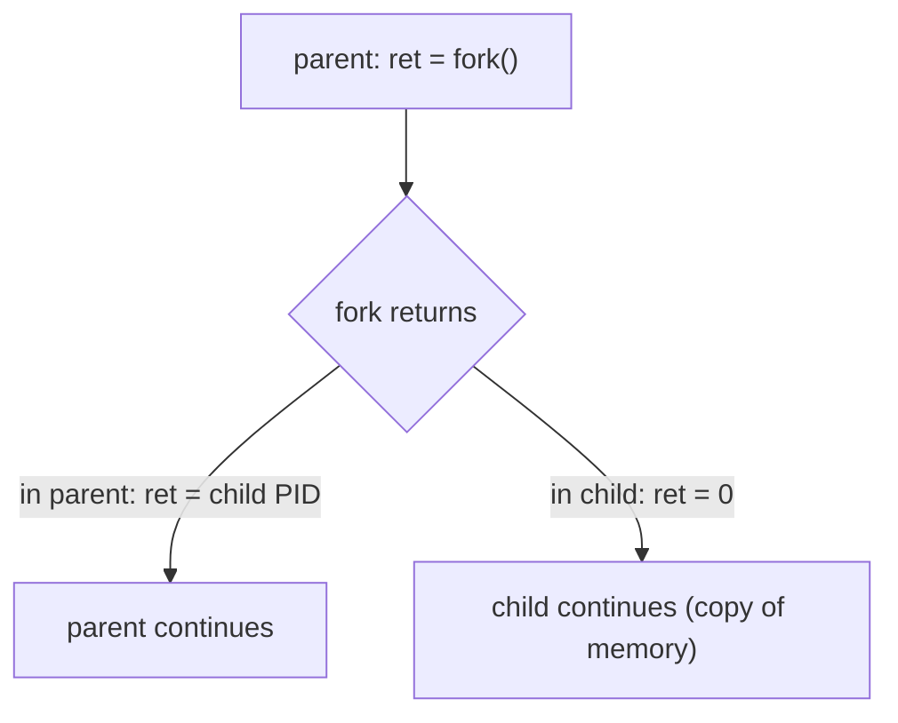
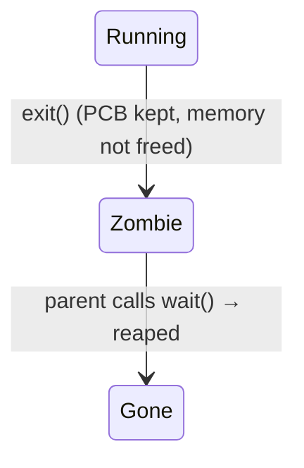
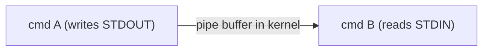

# 03 · Process System Calls (`fork`, `exec`, `wait`, `exit`)

> **In one line:** Unix builds every process from four calls — **`fork`** clones the caller, **`exec`** replaces
> a process's program, **`exit`** ends it, **`wait`** lets a parent reap a dead child — and the shell is just a
> `fork` + `exec` + `wait` loop.

Prereqs: [[02 - Processes]]. Next: [[04 - Trap Handling and Context Switching]]. See real code: [[25 - xv6 Process System Calls]].

---

## 1. The API

The OS exposes process management as **system calls** (POSIX standardizes them for portability). The four core
Unix calls:

| Call | Effect |
|---|---|
| `fork()` | create a new **child** process — a copy of the caller |
| `exec()` | replace the current process's memory image with a new program |
| `exit()` | terminate the calling process |
| `wait()` | block the parent until a child terminates, and reap it |

All processes descend from `init` (PID 1), created at boot; `init` forks the shell, which forks everything else.

## 2. `fork` — the clone

`fork()` creates a new child process with a **new PID**, whose memory image is a **copy** of the parent's. Both
then run the *same code* from the point right after `fork`.

The twist is the **return value**, which is how each copy learns who it is:

```c
int ret = fork();
if (ret == 0) {
    printf("I am the child\n");          // child sees 0
} else if (ret > 0) {
    printf("I am the parent, child=%d\n", ret);  // parent sees child's PID
}
// (ret < 0 means fork failed)
```



After `fork`, parent and child are **independent**: they have separate copies of all data, so changes in one do
not affect the other.

> [!note] Copies are logically independent, but implemented with copy-on-write
> Conceptually the child gets a full copy of the parent's address space. Real kernels use **copy-on-write**: both
> share the same physical pages read-only, and a page is physically duplicated only when one side writes it — so
> `fork` is cheap even for a large parent, and `fork`+`exec` doesn't waste a full copy. (Mechanism: [[13 - Paging]].)

### Worked example: diverging data
```c
int ret = fork();
int x = 1;
if (ret == 0)      { x = x + 1; printf("%d", x); }   // child prints 2
else if (ret > 0)  { x = x - 1; printf("%d", x); }   // parent prints 0
```
Each has its **own** `x`. Child → 2, parent → 0. The print **order** is non-deterministic (depends on scheduling).

### Worked example: nested fork
```c
fork();
fork();
printf("hello\n");
```
First `fork` → 2 processes. Each runs the second `fork` → 4 processes. "hello" prints **4** times.
(General rule: *n* consecutive `fork()`s with no exit → 2ⁿ processes.)

## 3. `exit`, zombies, and `wait`

**`exit()`** terminates a process; the OS stops scheduling it forever. (`exit` is called automatically at the end
of `main`.)

But a terminated process **can't fully clean up its own memory** (it's a subtle bootstrapping problem — the PCB
and exit status must survive so the parent can read them). So it lingers in a **zombie** state: dead, but its PCB
is still around holding its exit status.

**`wait()`** is how zombies get reaped. The parent calls `wait()` to clean up one dead child:

```c
int ret = fork();
if (ret == 0) { printf("child\n"); exit(0); }
else          { wait(NULL); printf("parent, child reaped\n"); }
```

`wait` semantics:
- If the child is **still running** → parent **blocks** until it exits.
- If the child has **already exited** (zombie) → reaps it and returns immediately.
- If the caller has **no children** → returns immediately, reaping nothing.
- `waitpid(pid, ...)` reaps a **specific** child; plain `wait` reaps **any** terminated child, one at a time.



> [!warning] Two classic bugs
> - **Zombie leak:** a parent that forks many children but never `wait`s fills the process table with zombies and
>   can exhaust system resources. Rule: every `fork` must eventually be matched by a `wait`.
> - **Orphans:** if the *parent* exits while the child still runs, the child becomes an **orphan** and is
>   re-parented to `init`, which `wait`s for it when it finally dies. Orphans are fine; zombies are the leak.

## 4. `exec` — become a different program

Running the *same* code in parent and child is often useless — you want the child to run a *different* program.
`exec("/bin/ls", ...)` **replaces** the process's entire memory image (code, data, stack, heap) with the new
executable and starts it from `main`. The PID stays the same.

```c
int ret = fork();
if (ret == 0) {
    execvp("ls", args);        // child becomes 'ls'
    printf("this never prints if exec succeeds\n");
}
else { wait(NULL); }
```

- If `exec` **succeeds**, control never returns — the old code is gone, so the line after `exec` doesn't run.
- If `exec` **fails** (e.g. no such file), it returns, and the old image is still intact (so you can handle the error).
- Many variants (`execvp`, `execl`, …) differ only in how you pass arguments/environment.

**The fork+exec pattern** — clone, then the clone transforms into the target program — is the universal way Unix
launches programs. (Windows uses a single `CreateProcess`; Unix's split is more flexible, e.g. it lets the parent
tweak the child's file descriptors *between* fork and exec — the basis of redirection below.)

## 5. The shell is a fork/exec/wait loop

```c
while (1) {
    cmd = read_input();
    int ret = fork();
    if (ret == 0)  exec(cmd);     // child becomes the command
    else           wait(NULL);    // shell waits, then loops for next command
}
```

- Commands like `ls`, `echo`, `cat` are just executables the shell `exec`s in a child.
- **Why fork a child instead of exec-ing directly?** Because `exec` *replaces* the caller — if the shell exec'd
  directly, the shell itself would be gone. Forking keeps the shell alive to read the next command.
- **`cd` is special:** it's built *into* the shell and uses `chdir()` on the **shell itself**, not a child. If it
  ran in a forked child, that child's working directory would change and then the child would exit — the shell's
  directory would be unchanged, so `cd` would do nothing.

**Background execution (`sleep 10 &`):** the shell forks the child but does **not** `wait`; it immediately prompts
for the next command. It reaps background children later (via a non-blocking wait variant).

## 6. I/O redirection and pipes

Every process has file descriptors open; by default **STDIN (0), STDOUT (1), STDERR (2)**. Because the parent
controls the child's FDs **between fork and exec**, it can rewire them:

**Output redirection `ls > foo.txt`:** in the child, *before* exec, **close STDOUT(1)** then **open `foo.txt`** —
`open` returns the lowest free descriptor, which is now 1, so the program's writes to STDOUT land in the file.

```
normal:              redirected (ls > foo.txt):
 STDIN  ← keyboard    STDIN  ← keyboard
 STDOUT → screen      STDOUT → foo.txt     (fd 1 reopened onto the file)
 STDERR → screen      STDERR → screen
```

**Pipes `A | B`:** the kernel provides a **pipe** (an in-kernel buffer with a read end and a write end). The
shell connects **A's STDOUT to the write end** and **B's STDIN to the read end**, so A's output streams straight
into B.



---

## Interview questions

> [!question] Q1. What does `fork` return, and why two different values?
> In the **child** it returns 0; in the **parent** it returns the child's PID (and −1 on failure). The asymmetry
> is the only way for otherwise-identical copies to tell which one they are and branch accordingly.

> [!question] Q2. How many times does this print "hello"? `fork(); fork(); printf("hello");`
> 4. Each `fork` doubles the process count: 1→2→4. In general *n* forks ⇒ 2ⁿ processes.

> [!question] Q3. What is a zombie? An orphan? How is each handled?
> A **zombie** is a process that has `exit`ed but whose PCB/exit-status is still kept because its parent hasn't
> `wait`ed yet. The parent reaps it with `wait`. An **orphan** is a live process whose parent died first; it's
> adopted by `init`, which reaps it when it eventually exits. Zombies that pile up are a resource leak; orphans
> are benign.

> [!question] Q4. Why `fork` then `exec` instead of one "create process running program X" call?
> The split lets the parent run code **in between** — most importantly, manipulate the child's file descriptors
> (redirection, pipes), set up environment, change UID, etc. — before the new program takes over. It also makes
> `fork` alone useful for worker-copy models. Windows bundles it into `CreateProcess`; Unix keeps it composable.

> [!question] Q5. Why is `cd` a shell built-in and not an external program?
> Changing directory must affect the **shell's own** working directory. An external program runs in a forked
> child; changing *its* directory and then exiting leaves the shell unchanged. So `cd` calls `chdir()` directly
> in the shell process.

> [!question] Q6. After `exec` succeeds, why doesn't the line after it run?
> `exec` replaces the entire memory image — the old code, including that line, no longer exists. Code after
> `exec` runs **only if `exec` failed** (useful for error handling).

> [!question] Q7. What happens to `wait` if the child already exited / if there are no children?
> Already exited → it reaps the zombie and returns immediately. No children → returns immediately, reaping
> nothing. Child still running → it blocks until the child exits.

## Five things to remember
1. **`fork`** clones (child gets 0, parent gets child PID); the copies are independent (copy-on-write under the hood).
2. **`exec`** replaces the image with a new program (same PID, no return on success); **`exit`** ends a process; **`wait`** reaps a dead child.
3. **Zombie** = exited but un-reaped (fix: `wait`); **orphan** = parent died first (adopted by `init`).
4. The **shell** = loop of `read → fork → exec → wait`; `cd` is a built-in (`chdir` on the shell itself).
5. Redirection/pipes work because the parent rewires the child's **file descriptors between fork and exec**.
