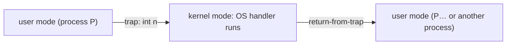
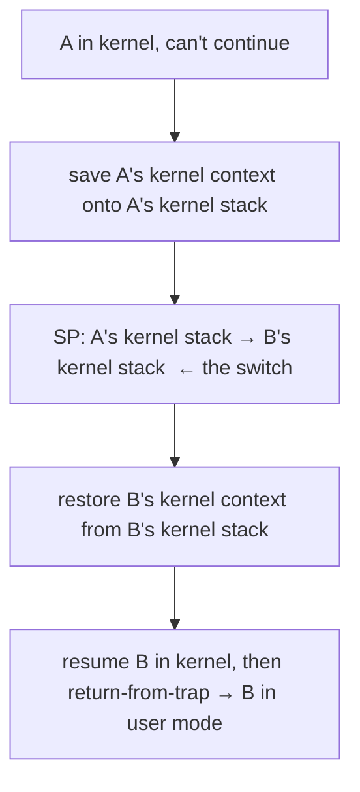

# 04 · Trap Handling and Context Switching

> **In one line:** a **trap** (syscall/interrupt/fault) is the *only* secure door from user mode into the kernel —
> the hardware saves user state on a protected **kernel stack** and jumps via the **IDT** to OS code — and a
> **context switch** is the OS, already in the kernel, swapping one process's saved kernel state for another's.

Prereqs: [[02 - Processes]], [[01 - Computer Architecture Background]] §7 (function calls). Real code: [[26 - xv6 Trap]], [[27 - xv6 Switch]].

---

## 1. Recap: when does the OS run?

Once a process is switched in, the CPU is in **user mode** running user code directly — **the OS is not running.**
The OS regains control only on a **trap**:

- **System call** — the process deliberately asks for a service.
- **Interrupt** — an external device (or the **timer**) demands attention.
- **Fault/exception** — the current instruction did something illegal.

All three: CPU raises privilege to **kernel mode**, runs OS code to handle the event, then lowers privilege and
returns to user mode. Crucially, **the OS is not a separate process** — it runs in the kernel mode *of the process
that trapped*. Process P traps → OS code runs "as P" → returns to P (or to someone else, if the OS decides to switch).



## 2. Function call vs system call — why we can't reuse the function-call machinery

A system call is *like* a function call (save context, change PC, run, restore) — but with two trust problems:

| | Function call | System call |
|---|---|---|
| Where to jump | known address in the executable; `call` jumps directly | **can't trust** the user to jump to the right OS code (they might jump into the middle of privileged code) |
| Which stack | the user stack | **can't trust** the user stack (user may have set up malicious values / a tiny stack) |

So the kernel needs **(a) a secure way to find the OS entry point** and **(b) a secure stack**. Hardware provides
both: the **IDT** and the **kernel stack**.

## 3. The two secure ingredients

**Kernel stack (per process).** Every process has a *separate* kernel stack, part of its PCB, living in OS memory
and **inaccessible in user mode**. Kernel-mode execution uses this stack, so the user can't tamper with it.

**Interrupt Descriptor Table (IDT).** A table set up by the OS at boot (and inaccessible in user mode) mapping an
**index `n` → address of the handler** for that event. Its base address is in a CPU register. The CPU uses the
IDT to decide where to jump — the user never provides the address.

```
         IDT (set up by OS at boot)
 index    handler address
  0   →  divide-by-zero handler
  1   →  debug handler
  ...
  n   →  system-call handler          ← CPU looks up IDT[n]
  ...
```

## 4. The trap instruction, step by step

User code (or a library) invokes a **trap instruction** with an argument — e.g. x86 `int n`, where `n` selects
the IDT entry (which syscall / which IRQ). When the CPU executes it, **the hardware** (not the OS) atomically:

1. Raises the privilege level to **kernel mode**.
2. Switches the **stack pointer** to this process's **kernel stack**.
3. **Saves the user register context** (PC, registers) on the kernel stack.
4. Looks up **IDT[n]** and sets PC to that OS handler.
5. OS code begins running — on a secure stack, at a known-good address.

```
BEFORE (user mode)                 AFTER `int n` (kernel mode)
 PC → user instruction              PC  = IDT[n]   (OS handler)
 SP → user stack                    SP  = top of kernel stack
                                     kernel stack now holds:
                                       [ saved user context: PC, regs ]
```

> [!note] The point
> Only the **CPU** can be trusted to hand control from user to OS. The user picks *which* service (`n`), but the
> **hardware** decides *where* to jump (IDT) and *which stack* to use (kernel stack). That's what makes the
> boundary secure.

**Who invokes the trap instruction?**
- a C library syscall wrapper (`printf` → `write` → `int n`),
- or external hardware raising an interrupt (the CPU is forced to run `int n` with the device's IRQ number).

## 5. Return-from-trap

When the OS finishes handling the event it executes a special **return-from-trap** instruction:
1. Restore the CPU registers from the saved context on the kernel stack.
2. Lower privilege: kernel → user mode.
3. Restore PC and jump back to the user instruction after the trap.

The user process is **unaware** it was interrupted — it resumes exactly where it stopped.

**But does it always return to the *same* process? No.** Before returning to user mode, the OS checks whether it
should switch to a *different* process. If so, it performs a **context switch** first.

## 6. Why switch processes at all?

- The running process **can't** continue: it `exit`ed, hit a fatal fault (segfault), or made a **blocking**
  syscall (waiting on I/O).
- The OS **doesn't want** it to continue: it has run **too long** and must time-share → this is **preemption**,
  driven by the **periodic timer interrupt**.

> **Cooperative (non-preemptive)** schedulers switch only when a process blocks or exits (one runaway process
> hangs the machine). **Preemptive** schedulers use the timer interrupt to forcibly take the CPU back — every
> modern OS is preemptive. (Policy of *who* runs next: [[05 - CPU Scheduling]].)

## 7. The mechanism of a context switch

Key insight: **two kinds of context get saved on the kernel stack, at two different times.**

- **User context** — where the process stopped *in user mode*. Saved by the **trap instruction** on entry
  (§4), restored by **return-from-trap**.
- **Kernel context** — where the process stopped *in kernel mode* (inside the OS). Saved by the **context-switch
  code**, restored when this process is scheduled again.

A switch from process A to process B, when both are already in the kernel:

```
(1) A is in kernel mode. A's kernel stack already holds A's USER context (from the trap).
    A can't continue (e.g. disk read pending). Scheduler picks B.

(2) OS saves A's KERNEL context (PC, regs, kernel SP) onto A's kernel stack.
      A's kernel stack:  [ kernel context ][ user context ]

(3)  ****the actual switch****: change SP from A's kernel stack → B's kernel stack.
      This single pointer swap IS the context switch.

(4) B's kernel stack already holds (from when B was switched out earlier):
      [ B's kernel context ][ B's user context ]
    OS restores B's kernel context → resumes in B's kernel code where B left off,
    then return-from-trap pops B's user context → resumes B in user mode.
```



**Why save context *twice* (user and kernel)?** Because the process stopped at two levels: the trap captured where
it was in *user* code; the context switch captures where it was in *OS* code. Both must be restored to resume
cleanly. When B is switched back in, it first continues the OS code it was running, *then* returns to its own user
code.

> [!tip] The one-sentence version for an interview
> "A trap saves **user** context on the kernel stack and jumps via the IDT into the kernel; a context switch saves
> the **kernel** context on the old process's kernel stack and switches the stack pointer to the new process's
> kernel stack — so switching processes is ultimately swapping which kernel stack the CPU is standing on."

---

## Interview questions

> [!question] Q1. Why can't a system call just use `call` like a normal function?
> Two trust problems: the kernel can't let the user choose the jump target (they might jump into the middle of
> privileged code), and it can't trust the user's stack (malicious/tiny). So the hardware forces the jump target
> through the **IDT** and switches to a protected **kernel stack**. The user only supplies an *index* (`n`), not
> an address.

> [!question] Q2. What exactly does the hardware do when a trap instruction executes?
> Atomically: raise privilege to kernel mode, switch SP to the process's kernel stack, push the user context
> (PC + registers) onto it, look up IDT[n] to find the handler, and set PC there. Then OS code runs.

> [!question] Q3. Is the OS a process? Whose stack does it run on?
> No — the OS runs in the **kernel mode of whatever process trapped**, on **that process's kernel stack**. There's
> one kernel stack per process (in its PCB), separate from its user stack.

> [!question] Q4. What's the difference between the user context and the kernel context in a switch?
> User context = where the process was in *user* code; saved by the trap, restored by return-from-trap. Kernel
> context = where the process was in *OS* code; saved/restored by the context-switch routine. A switched-out
> process's kernel stack holds **both**, so it can resume the OS code first and then return to user code.

> [!question] Q5. What is the single action that *is* the context switch?
> Changing the stack pointer from the old process's kernel stack to the new process's kernel stack (plus
> swapping the saved register/PC context around it). After the SP swap, the CPU is "standing on" the new
> process's kernel stack and will restore its state. (In xv6 this is the `swtch` routine — [[27 - xv6 Switch]].)

> [!question] Q6. Preemptive vs cooperative scheduling — what makes preemption possible?
> Cooperative: the OS only runs when a process yields/blocks/exits, so a runaway loop hangs the machine.
> Preemptive: the hardware **timer interrupt** periodically forces a trap into the OS, which can then decide the
> process has run long enough and switch it out. The timer interrupt is the key enabling mechanism.

> [!question] Q7. A process calls a blocking `read()`. Trace the traps.
> `read()` → trap into kernel (user context saved, jump via IDT). OS issues disk I/O, sees data isn't ready,
> marks the process **blocked**, saves its **kernel** context, and **context-switches** to another process. Later
> a **disk interrupt** traps in, OS marks the first process **ready**. Eventually the scheduler switches back to
> it, restores its kernel context, and **return-from-trap** resumes its user code with the data. (Two traps in,
> one switch out, one switch back, one return.)

## Five things to remember
1. A **trap** (syscall/interrupt/fault) is the only user→kernel door; the OS runs in the **kernel mode of the trapping process**.
2. Security comes from the **IDT** (CPU, not user, chooses the jump target) + the per-process **kernel stack** (user can't touch it).
3. On a trap the **hardware** saves user context on the kernel stack and jumps to IDT[n]; **return-from-trap** undoes it.
4. A **context switch** saves the **kernel** context and swaps the **stack pointer** between kernel stacks — that SP swap is the switch.
5. Two contexts are saved at two levels: **user** (by the trap) and **kernel** (by the switch); both must be restored to resume. Preemption is driven by the **timer interrupt**.
