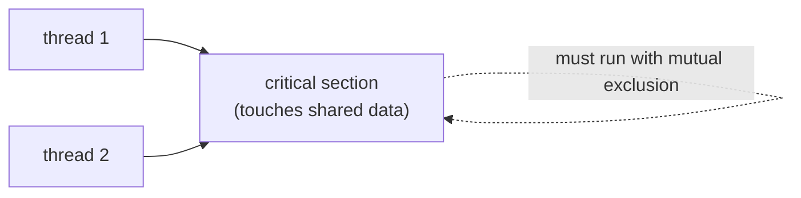

# 06 · Threads

> **In one line:** a thread is a lightweight unit of execution *inside* a process — threads of one process
> **share** its code/data/heap but each has its **own stack and registers** — which makes them cheap and great
> for parallelism, but also means they step on shared data and create **race conditions** unless you add
> synchronization.

Prereqs: [[02 - Processes]], [[05 - CPU Scheduling]]. Next: [[07 - Locks]], then [[08 - Condition Variables]], [[09 - Semaphores]].

---

## 1. Why threads?

A process often wants to do several things at once: a web server handling many clients, a program parallelizing a
matrix multiply. Two ways to get concurrency:

- **Multiple processes** running the same program → wasteful: each carries a full copy of the memory image, and
  sharing data between them needs [[10 - Inter-Process Communication|IPC]].
- **Multiple threads** in one process → cheap: they **share one memory image**, so they use less memory and can
  share data directly.

A thread is a **"lightweight process."** A process starts with one thread and can create more.

## 2. What a thread shares vs owns

```
        ┌──────────────── one process ────────────────┐
        │  SHARED by all threads:                       │
        │     code (text)                               │
        │     global/static data                        │
        │     heap (malloc)                             │
        │     open files, PID                           │
        │                                               │
        │  PER-THREAD (private):                        │
        │     ┌─ thread 1 ─┐   ┌─ thread 2 ─┐           │
        │     │ stack      │   │ stack      │           │
        │     │ PC, SP     │   │ PC, SP     │           │
        │     │ registers  │   │ registers  │           │
        │     └────────────┘   └────────────┘           │
        └───────────────────────────────────────────────┘
```

- **Shared:** code, globals/statics, heap, open files — this is why threads communicate so easily (just read/write
  the same variable) *and* why they race.
- **Private:** each thread has its own **stack** (for its own function calls), its own **PC** (it's running a
  different place in the code), and its own **register context**.

## 3. Concurrency vs parallelism (know the difference cold)

- **Concurrency:** multiple threads *in progress at the same time*, possibly by **interleaving** on a single core.
- **Parallelism:** multiple threads *literally executing at the same instant* on **different cores**.

Threads give you **both** payoffs:
- On **multiple cores** → true parallelism (speed up a matrix multiply by splitting rows across threads).
- Even on a **single core** → concurrency keeps the CPU busy: if one thread **blocks** on I/O, another runs.

> Parallelism needs multiple cores; concurrency does not. Threads enable both.

## 4. The pthreads API

```c
void *f1(void *arg) { /* thread 1 work */ return NULL; }
void *f2(void *arg) { /* thread 2 work */ return NULL; }

int main() {
    pthread_t t1, t2;
    pthread_create(&t1, NULL, f1, NULL);   // start t1 in f1
    pthread_create(&t2, NULL, f2, NULL);   // start t2 in f2
    pthread_join(t1, NULL);                // wait for t1 to finish
    pthread_join(t2, NULL);                // (join is the thread analog of wait)
}
```

Each thread is given a **start function** where it begins. After creation it runs independently; the parent may
**join** (wait) for it. `pthread_create`/`join` are the thread analogs of `fork`/`wait`.

## 5. Kernel threads vs user threads

- **Kernel threads:** the kernel knows about each thread and schedules them **independently** (so two threads of
  one process can run on two cores in parallel, and one blocking doesn't block the others). Linux pthreads are
  kernel threads. Each has a **Thread Control Block (TCB)** holding its context; a PCB has one or more linked TCBs.
- **User threads:** a library multiplexes many user threads onto *one* kernel thread. The kernel sees one thread,
  so they **can't run in parallel** and one blocking syscall blocks all of them (unless the library works around
  it). Why use them? Cheaper creation/switching and easier programming (the basis of goroutines, green threads).

## 6. The problem threads create: race conditions

Because threads share memory, concurrent updates to the same variable can corrupt it. Classic example — two
threads each increment a shared `counter` 10⁷ times; expected final value 2×10⁷, but you often get **less**.

Why? `counter = counter + 1` is **not atomic** — it compiles to three instructions:
```
load  counter → reg      # read
reg = reg + 1            # modify
store reg → counter      # write
```

A bad interleaving loses an update:
```
counter = 0
T1: load counter→reg   (reg=0)
T1: reg = reg+1        (reg=1)
--- context switch (T1's reg=1 saved) ---
T2: load counter→reg   (reg=0)   ← still 0! T1 hasn't stored yet
T2: reg = reg+1        (reg=1)
T2: store reg→counter  (counter=1)
--- resume T1 (reg=1 restored) ---
T1: store reg→counter  (counter=1)   ← overwrites, should be 2
Final: counter = 1, expected 2        ← a lost update
```

- A **race condition** = wrong result caused by *unlucky timing* of interleaving — the atomicity of a logical
  update was violated.
- It needs **concurrent access to shared data**: threads sharing process memory, *or* processes in kernel mode
  sharing OS data structures (the kernel has races too).
- The fix: **mutual exclusion** — let only one thread at a time execute the code that touches the shared data.
- That code is a **critical section**. The tool to protect it: **locks** → [[07 - Locks]].



---

## Interview questions

> [!question] Q1. Thread vs process — what's shared, what's private?
> Threads of one process share **code, globals, heap, open files**; each thread has its **own stack, PC, and
> registers**. Processes share **nothing** by default (separate address spaces). Threads are cheaper to create and
> switch, and communicate via shared memory; processes are isolated and communicate via IPC.

> [!question] Q2. Concurrency vs parallelism?
> Concurrency = multiple tasks in progress at once, possibly interleaved on one core. Parallelism = multiple tasks
> executing simultaneously on multiple cores. Parallelism requires multiple cores; concurrency does not.
> Concurrency still helps on one core by overlapping computation with another thread's I/O wait.

> [!question] Q3. Why can `counter++` across two threads lose updates?
> It's not atomic — it's load/increment/store. If a context switch happens between one thread's load and store,
> the other thread reads the stale value, and one increment is overwritten. That's a race condition; the fix is a
> lock around the update.

> [!question] Q4. What is a critical section, and what property must hold on it?
> A critical section is the code that accesses shared data and must not be run by more than one thread at a time.
> The required property is **mutual exclusion** — at most one thread inside at any instant.

> [!question] Q5. Kernel threads vs user threads — trade-offs?
> Kernel threads are scheduled by the OS → real parallelism across cores, and one blocking doesn't block the rest,
> but creation/switching involves the kernel (costlier). User threads are a library abstraction over one kernel
> thread → very cheap and flexible, but no parallelism and a blocking syscall can stall all of them. Modern
> runtimes often use an M:N hybrid.

> [!question] Q6. If threads share memory and that causes races, why not just use processes?
> Processes are isolated (safer) but heavier: duplicated memory images and IPC overhead for every shared byte.
> Threads trade that safety for cheap sharing and parallelism — you pay it back by disciplined locking. Choose
> processes for isolation/fault-containment, threads for tight data sharing and performance.

## Five things to remember
1. A thread shares its process's **code/data/heap/files** but has a **private stack, PC, and registers**.
2. **Concurrency** (interleaving, even 1 core) ≠ **parallelism** (simultaneous, needs many cores); threads give both.
3. `pthread_create`/`pthread_join` ≈ `fork`/`wait`; Linux pthreads are **kernel threads** (independently scheduled).
4. Sharing causes **race conditions** because operations like `counter++` aren't atomic (load/modify/store).
5. Protect the **critical section** with **mutual exclusion** → use **locks** ([[07 - Locks]]).
