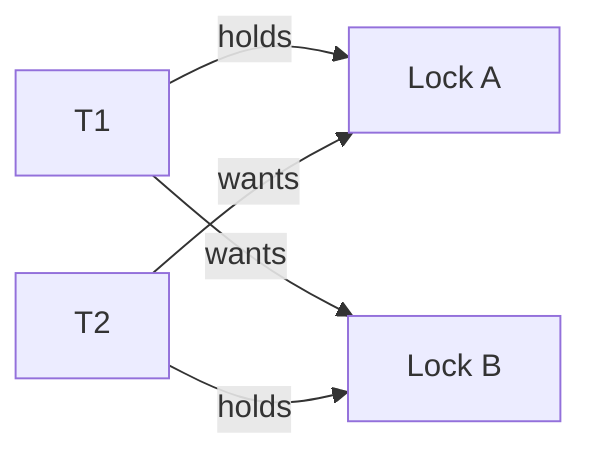

# 08 · Condition Variables

> **In one line:** locks give mutual exclusion, but condition variables give the *other* kind of coordination —
> **wait for an event / signal when it happens** — and the two rules that make them correct are: always pair the
> CV with a **mutex**, and always re-check the condition in a **`while` loop**.

Prereqs: [[07 - Locks]], [[06 - Threads]]. Pairs with [[09 - Semaphores]] (another way to do the same thing).

---

## 1. The need: waiting for an event

Locks solve "don't both touch this at once." They **don't** solve "T2 should run only *after* T1 finishes its
work." The naive fix — T2 **polls** (`while(!done);`) — wastes CPU spinning. We want T2 to **sleep** until T1
wakes it. That primitive is the **condition variable (CV)**.

- `wait(cv)` — block the calling thread, add it to the CV's wait queue, give up the CPU.
- `signal(cv)` — wake **one** waiting thread (it becomes *ready*; no immediate switch).
- `broadcast(cv)` — wake **all** waiting threads.

> Signal makes a waiter *runnable*; it does **not** hand it the CPU right now. The woken thread runs when the
> scheduler next picks it.

## 2. The missed-wakeup problem → why a CV needs a mutex

Checking the condition and going to sleep must be **atomic**. If not:

```
T2:  if (!done)
     --- context switch, just before T2 actually sleeps ---
T1:  done = true
T1:  signal(cv)        ← wakes nobody; T2 isn't asleep yet!
     --- resume T2 ---
T2:  wait(cv)          ← sleeps forever; the signal already happened
```

This **lost / missed wakeup** deadlocks T2 permanently. The fix: hold a **mutex** around the check-and-wait, and
require the signaller to hold the *same* mutex:

```c
// T2 (waiter)                     // T1 (signaller)
lock(mutex);                       lock(mutex);
while (!done)                      done = true;
    wait(cv, mutex);  // atomic!   signal(cv);
// ... proceed ...                 unlock(mutex);
unlock(mutex);
```

The magic is in `wait(cv, mutex)`: it **atomically** (a) adds the thread to the wait queue *and* (b) releases the
mutex — and on wakeup it **re-acquires** the mutex before returning. Because releasing the lock and sleeping are
one atomic step, the signaller (which needs the same lock) cannot sneak its `signal` into the gap. No missed
wakeup.

```mermaid
sequenceDiagram
    participant T2 as T2 (waiter)
    participant M as mutex
    participant T1 as T1 (signaller)
    T2->>M: lock
    T2->>T2: while(!done) → wait(cv, mutex)
    Note over T2,M: wait ATOMICALLY releases mutex + sleeps
    T1->>M: lock (now free)
    T1->>T1: done = true; signal(cv)
    T1->>M: unlock
    Note over T2: wakes, re-acquires mutex, re-checks while → done, proceeds
```

## 3. The two golden rules

> [!important] Rule 1 — one mutex, shared by waiter and signaller
> Use the **same** lock for the `wait` and the `signal` (and for the shared variables they test/set). This is
> what gives the missed-wakeup protection above.

> [!important] Rule 2 — always `while`, never `if`
> Re-check the condition in a **`while` loop**, not an `if`:
> ```c
> while (!done) wait(cv, mutex);   // ✓ correct
> if    (!done) wait(cv, mutex);   // ✗ wrong
> ```
> Reasons: **spurious wakeups** (some implementations may wake a waiter without a real signal); **`broadcast`**
> wakes everyone but only one can proceed (the rest must re-check and go back to sleep); and by the time a woken
> thread re-acquires the mutex, another thread may have already consumed the condition. The `while` guarantees the
> thread only proceeds when the condition is *actually* true.

Also: before waiting, confirm the condition is genuinely false — otherwise you might wait for an event that
already happened (that's partly what the `while` enforces).

## 4. Worked example: producer–consumer (bounded buffer)

A buffer of N slots. Producers add items (wait if **full**); consumers remove items (wait if **empty**). Two CVs:

```c
// Producer                              // Consumer
lock(mutex);                             lock(mutex);
while (buffer is full)                   while (buffer is empty)
    wait(cv_producer, mutex);                wait(cv_consumer, mutex);
produce item; add to buffer;             consume item from buffer;
signal(cv_consumer);  // space→item      signal(cv_producer);  // slot freed
unlock(mutex);                           unlock(mutex);
```

- One mutex protects the buffer; two CVs so producers and consumers wait on the *right* event.
- Producer, after adding, signals a **consumer** (there's now an item). Consumer, after removing, signals a
  **producer** (there's now a free slot). This is the canonical pattern — also used for a **multi-threaded
  server** (a master thread puts client connections in a queue; worker threads wait on the queue).

## 5. Worked example: batched processing (and the classic bug)

N request threads; a batch processor that waits for N requests then releases them all (think: a nurse waits for
10 patients, opens the 10-dose vial, vaccinates all 10).

**The buggy version** — the Nth request thread `wait`s *before* it gets to the `signal` that would wake the processor:
```c
// Request (BUGGY)                         // Batch processor
lock(mutex);                               lock(mutex);
count++;                                   while (count < N)
while (!batch_started)                         wait(cv_batch, mutex);
    wait(cv_request, mutex);  // ← sleeps  batch_started = true;
if (count == N)                            broadcast(cv_request);
    signal(cv_batch);  // ← never reached! unlock(mutex);
unlock(mutex);
```
When the **Nth** request thread arrives, it should wake the processor — but here it hits `wait(cv_request)` and
sleeps *first*, so its `signal(cv_batch)` never runs. The processor stays blocked at `while(count<N)`, so it never
broadcasts, so no request thread is ever released → **everyone sleeps forever.**

**The fix (correct version):** do the signalling *before* you block.
```c
// Request (CORRECT)
lock(mutex);
count++;
if (count == N) signal(cv_batch);   // wake the processor FIRST
while (!batch_started)
    wait(cv_request, mutex);        // only now block
unlock(mutex);
```
**The rule it teaches:** *before you go to sleep, make sure the code that will wake you can still run* — signal
whoever you depend on **before** blocking yourself.

## 6. Deadlock — the ever-present danger

A **deadlock** = threads stuck blocked forever, no progress. Two flavors from this topic:

1. **Lost wakeup / sleep-with-no-waker:** a thread `wait`s but nothing will ever `signal` it (the batch bug).
   Fix: *ensure someone can always wake you* — arrange the signalling path before you sleep.
2. **Circular wait on multiple locks:**
   ```
   T1: lock(A); lock(B);      T2: lock(B); lock(A);
   ```
   If T1 grabs A and T2 grabs B, each waits forever for the other's lock. Fix: **acquire locks in the same global
   order** in every thread (e.g. always A before B).



---

## Interview questions

> [!question] Q1. What is a condition variable and how is it different from a lock?
> A lock provides **mutual exclusion** (one thread in a critical section). A CV provides **event waiting**: a
> thread sleeps on `wait` until another thread calls `signal`/`broadcast`. They're complementary and used
> together — a CV always rides on a mutex.

> [!question] Q2. Why must `wait` take a mutex, and what does it do with it?
> To prevent the **missed-wakeup** race: checking the condition and going to sleep must be atomic. `wait`
> atomically releases the mutex and sleeps, then re-acquires it on wakeup. Because the signaller holds the same
> mutex, it can't signal in the gap between the waiter's check and its sleep.

> [!question] Q3. Why re-check the condition with `while` instead of `if`?
> Because of spurious wakeups, `broadcast` waking multiple threads when only one can proceed, and another thread
> consuming the condition before the woken thread re-acquires the lock. `while` forces a re-check so a thread only
> proceeds when the condition is truly satisfied.

> [!question] Q4. `signal` vs `broadcast`?
> `signal` wakes one waiter; `broadcast` wakes all. Use `broadcast` when the event may satisfy several waiters or
> when waiters are waiting on different sub-conditions and you can't tell which to wake; use `signal` when exactly
> one waiter can make progress (and with a `while` loop, `broadcast` is always *safe* if slightly wasteful).

> [!question] Q5. Write producer–consumer with CVs.
> (See §4.) One mutex for the buffer, two CVs. Producer: lock, `while(full) wait(cv_producer)`, add,
> `signal(cv_consumer)`, unlock. Consumer: lock, `while(empty) wait(cv_consumer)`, remove,
> `signal(cv_producer)`, unlock.

> [!question] Q6. How do deadlocks arise with CVs/locks and how do you prevent them?
> (1) Sleeping with no possible waker — ensure the signalling path runs before you block. (2) Circular lock
> acquisition — impose a **global lock ordering** so all threads grab locks in the same order. Other classic
> conditions (the Coffman conditions): mutual exclusion, hold-and-wait, no preemption, circular wait; break any
> one to prevent deadlock.

## Five things to remember
1. CVs do **event waiting** (`wait`/`signal`/`broadcast`); locks do **mutual exclusion** — use them together.
2. **Always pair a CV with a mutex**; `wait` atomically releases the lock + sleeps, re-acquires on wakeup → no **missed wakeup**.
3. **Always re-check the condition in a `while` loop** (spurious wakeups, broadcast, stolen condition).
4. Canonical pattern: **producer–consumer** = one mutex + two CVs (wait-if-full / wait-if-empty).
5. Before you sleep, make sure someone can still wake you; avoid **circular lock ordering** to dodge deadlock.
