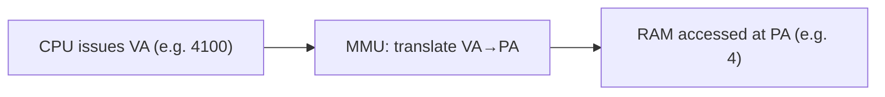

# 11 · Memory Introduction (Address Spaces)

> **In one line:** every process gets a private **virtual address space** starting at 0; the **MMU** translates
> each virtual address to a physical one on every access; the story of *how* it maps goes base-and-bounds →
> segmentation → **paging** (today's winner, because it kills external fragmentation).

Prereqs: [[01 - Computer Architecture Background]] (memory image), [[00 - OS Introduction]]. Next: [[12 - Memory System Calls]], [[13 - Paging]], [[14 - Demand Paging]].

---

## 1. Physical vs virtual addressing

The CPU fetches code/data by **address**. Two models:

- **Physical addressing:** the CPU uses the real byte number in RAM. Problems: the compiler would need to know the
  physical location at compile time; you couldn't relocate a process; and with many processes time-sharing memory
  non-contiguously, it's a mess and gives no protection.
- **Virtual addressing (modern):** code/data get **virtual addresses** starting at 0. On every access, the
  **MMU** (Memory Management Unit, hardware) translates virtual → physical using info the OS set up.



## 2. The virtual address space

Each process assumes it owns a big contiguous space `0 … max`, where max depends on address width (2³² = 4 GB on
a 32-bit machine). Everything the process can touch — its code, data, heap, stack — lives there, and **every
pointer value and register address is a virtual address.**

**Why virtualize memory?**
- Real memory is **messy**: many processes, allocated non-contiguously all over RAM.
- The physical location **isn't known at compile time**, and the process may be relocated.
- **Isolation/protection**: each process sees only its own space.

## 3. Division of labor: OS vs MMU

- **OS**: allocates physical memory and **builds the translation information** (base/bound or page tables) for
  each process. On every **context switch**, it hands the MMU the new process's translation info.
- **MMU**: does the **actual translation on every memory access** — the OS is *not* involved per-access (it's out
  of the picture once user code runs). The MMU **traps to the OS** if translation fails (out-of-bounds, missing
  page, permission violation).

This split is the whole point: translation is far too frequent (every instruction fetch, every load/store) to run
OS code each time, so it's done in hardware; the OS only sets policy and handles the rare traps.

## 4. Base and bounds (the simplest scheme)

Place the whole memory image `[0, N]` **contiguously** starting at physical address **base B**. Translate
`PA = VA + base`; trap if `VA > bound (N)`.

```
VA = 128,  base = 32KB  →  PA = 32KB + 128 = 32896
VA = 1KB,  base = 32KB  →  PA = 33KB
VA = 20KB (> bound)     →  TRAP (out of bounds)
```

The OS stores base and bound in MMU registers; on a context switch it swaps in the new process's values. Simple
and fast, but it forces each process's memory to be one **contiguous** physical block → leads to **external
fragmentation** (free memory exists but is scattered in unusable gaps).

## 5. Segmentation (generalized base/bounds)

Give each **segment** (code, data, stack, heap) its *own* base and bound, placed separately in memory.
`VA = (segment id : offset)`, `PA = segment_base + offset`, with the offset checked against the segment bound.

- The MMU holds several (base, bound) pairs. An access past a segment's bound → **segmentation fault** (traps to
  the OS, usually terminating the process — yes, *that* segfault).
- Better than one big block, but segments are still variable-sized contiguous chunks → **still external
  fragmentation.**

## 6. Paging (the modern scheme — detail in [[13 - Paging]])

Split the virtual address space into **fixed-size pages** (e.g. 4 KB); split physical memory into equal-size
**frames**; the OS maps each virtual page to any free physical frame via a **page table**.

```
Virtual pages        Page table (VPN→PFN)        Physical frames
  page 0  ───────────►  3  ──────────────────►  frame 3
  page 1  ───────────►  7  ──────────────────►  frame 7
  page 2  ───────────►  5  ──────────────────►  frame 5
  page 3  ───────────►  2  ──────────────────►  frame 2
```

- **Kills external fragmentation**: any free frame fits any page (all the same size), so no unusable gaps.
- **Cost**: **internal fragmentation** — a partially used page wastes the rest of that page (at most ~one page per
  region). A good trade.
- **TLB** (Translation Lookaside Buffer): since every access would otherwise need an extra memory read to consult
  the page table, the MMU **caches recent VPN→PFN translations** in the TLB. TLB hit → translate with no extra
  memory access; TLB miss → "page-table walk." (Full mechanism: [[13 - Paging]].)

> [!note] Fragmentation, the two kinds
> **External**: free memory is fragmented into scattered gaps too small/awkward to use (base-bounds, segmentation,
> variable-size heap allocation). **Internal**: space is wasted *inside* an allocated fixed-size unit (paging's
> partially filled page). Paging trades external for a little internal — usually a win.

---

## Interview questions

> [!question] Q1. Why virtual addresses instead of physical?
> Physical addressing can't be known at compile time, prevents relocation, gives no isolation, and can't handle
> many processes scattered non-contiguously in RAM. Virtual addressing lets every process pretend it owns a clean
> space from 0, while the OS+MMU map that onto whatever physical frames are free — giving relocation, isolation,
> and simpler compilation.

> [!question] Q2. Who translates addresses — the OS or the hardware? Why?
> The **MMU (hardware)** does it on every access, because translation happens on every instruction/load/store —
> far too often to run OS code. The **OS** only builds the translation tables and swaps them in on a context
> switch, and handles the rare traps (faults, violations).

> [!question] Q3. Base-and-bounds vs segmentation vs paging?
> Base/bounds: one contiguous block per process (`PA=VA+base`), simple but coarse. Segmentation: per-segment
> base/bounds, finer but still variable-size contiguous chunks. All contiguous schemes suffer **external
> fragmentation**. Paging: fixed-size pages→frames via a page table — eliminates external fragmentation at the
> cost of a little **internal** fragmentation; it's what modern systems use.

> [!question] Q4. External vs internal fragmentation?
> External: usable free memory exists but is split into gaps too small to satisfy a request (contiguous schemes).
> Internal: memory is wasted *within* a fixed allocation unit, e.g. a mostly-empty 4 KB page. Paging converts the
> former (bad, unbounded) into the latter (bounded to < one page per region).

> [!question] Q5. Where did the name "segmentation fault" come from?
> From the segmentation scheme: accessing beyond a segment's bound raised a **segmentation fault** that traps to
> the OS. The name stuck for any invalid memory access, even though modern systems use paging.

## Five things to remember
1. Each process has a **virtual address space** from 0; the **MMU** translates VA→PA on every access.
2. **OS builds** translation info and swaps it in per context switch; **MMU translates** per access and **traps** on errors.
3. **Base+bounds** (`PA=VA+base`) → **segmentation** (per-segment base/bounds) → both cause **external fragmentation**.
4. **Paging** = fixed-size pages→frames via a page table; kills external fragmentation, costs a little **internal**.
5. The **TLB** caches recent translations so most accesses skip the page-table lookup (details in [[13 - Paging]]).
