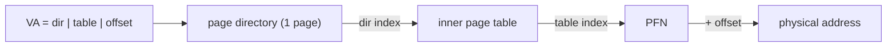
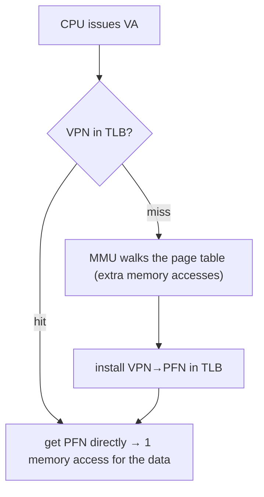

# 13 · Paging

> **In one line:** split virtual memory into fixed pages and physical memory into equal frames; a per-process
> **page table** maps VPN→PFN; because a flat table is huge, use a **multi-level** table that the MMU *walks*; and
> because walking is slow, the **TLB** caches recent translations.

Prereqs: [[11 - Memory Introduction]]. Pairs with [[14 - Demand Paging]]. Real code (RISC-V): [[24 - xv6 Memory]].

---

## 1. The page table

A virtual address space of pages maps to physical frames via a **page table** — a per-process array where entry
*i* holds the physical frame number (PFN) of virtual page *i*:

```
page table = [3, 7, 5, 2]   →  page0→frame3, page1→frame7, page2→frame5, page3→frame2
```

- It lives in **OS memory** (part of the PCB). The MMU is told where the current process's page table is via a
  CPU register, the **Page Table Base Register (PTBR)**, which the OS updates on **every context switch**.

## 2. Address translation

Split the virtual address into **VPN (high bits) + offset (low bits)**:

```
 32-bit VA, 4KB pages (offset = 12 bits):
 ┌──────────── 20 bits ───────────┬──── 12 bits ────┐
 │     virtual page number (VPN)   │      offset      │
 └─────────────────────────────────┴──────────────────┘
          │                                  │
          │ index into page table            │ (offset is unchanged)
          ▼                                  ▼
 ┌──────── PFN ────────┬──── offset ────┐
 │  physical frame no. │     offset      │  = physical address
 └─────────────────────┴──────────────────┘
```
The offset is unchanged (it's the byte within the page); only the page number is translated. MMU: `VPN` indexes
the page table → `PFN`; `PA = PFN·pagesize + offset`.

## 3. The Page Table Entry (PTE)

Each PTE holds the PFN **plus status/permission bits**:
- **Valid** — is this virtual page in use at all? (Most of a 4 GB space is unused → invalid.) Invalid access →
  trap.
- **Permissions** — read / write / execute; **user vs kernel** (can this page be touched in user mode?).
- **Present** — is the page currently in a physical frame (vs swapped to disk)? → [[14 - Demand Paging]].
- **Dirty** (modified) and **Accessed** (recently used) — set by the MMU, used by replacement policies.

> [!note] Why the page table is a fixed-size array, not a "smart" dynamic structure
> It has an entry for **every** page in the address space (even unused ones). Why not a compact structure sized to
> used pages? Because the **MMU traverses it in hardware** — the traversal logic is baked into the chip, so the
> structure's shape is fixed by the architecture. A simple indexable array is what hardware can walk fast.

## 4. Page tables are huge → multi-level page tables

**The size problem (32-bit, 4 KB pages):**
```
VA space = 2³² = 4 GB ;  page = 2¹² = 4 KB
#pages = 2³² / 2¹² = 2²⁰ = 1M entries
PTE = 4 bytes  →  page table = 4 bytes × 1M = 4 MB  ... PER PROCESS
```
4 MB of *contiguous* memory per process, mostly for invalid entries — and memory is allocated in 4 KB pages
anyway. Untenable.

**The fix — split the page table and page the page table:**
- Chop the 4 MB table into 1024 pages of 4 KB (each holding 1024 PTEs).
- A top-level **page directory** stores the frame numbers of those 1024 inner tables (and fits in one page).

```
   VA: [ 10 bits dir ][ 10 bits table ][ 12 bits offset ]
         │              │
         ▼              ▼
   page directory → inner page table → PFN  (+ offset → PA)
```



**The payoff — sparsity:** inner tables are created **only when they contain a valid entry**. A process with 2 K
pages of code/data + 1 stack page needs just the first two inner tables + one for the stack; the rest of the
directory entries are null. So the page table's size tracks *used* memory, not the whole 4 GB. This is the real
reason multi-level tables exist — not just fitting in pages, but **not storing the vast empty middle.**

**More levels for bigger address spaces (64-bit):** a 48-bit VA with 4 KB pages and 8-byte PTEs needs a
**4-level** table (9 bits index each level + 12-bit offset). x86-64 today uses 4 (or 5) levels. The cost: on a
TLB miss the MMU does **one memory access per level** (4 accesses to translate one address) — which is exactly
why the TLB matters so much.

## 5. The TLB (Translation Lookaside Buffer)

Without caching, every memory access needs **extra** memory accesses just to read the page table (1 per level).
The MMU caches recent **VPN→PFN** translations in the **TLB** (a small, fast, fully-associative cache):



- **TLB hit** → translate with no page-table access.
- **TLB miss** → page-table **walk** (expensive, especially multi-level), then cache the result.
- The TLB caches **translations** (VPN→PFN), *not* data — unlike the CPU data cache, which caches memory contents.
- **On a context switch, TLB entries become stale** (the new process has different mappings) → the TLB is
  **flushed** (or entries are tagged with an address-space ID, ASID, to avoid flushing).
- **High TLB hit rate and high CPU-cache hit rate are both critical** for performance.

## 6. The OS lives in every address space

A subtle but favorite point: **the OS is not a separate process with its own address space.** OS code/data is
mapped into the **high virtual addresses** of *every* process's address space (the compiler keeps user code out
of that range):

- There's **one physical copy** of the kernel in RAM (loaded at low physical addresses at boot); every process's
  page table maps the same high virtual addresses to those same physical frames.
- **Why?** So that on a **trap**, the CPU can just jump to kernel code at a known high virtual address — no
  address-space switch needed ([[04 - Trap Handling and Context Switching]]).
- **Protection:** the kernel's PTEs are marked **kernel-mode only**. In user mode, touching those high addresses
  → MMU traps. After a trap (kernel mode), the same pages are accessible. Code pages are **read-only**, data pages
  read-write — all enforced by **per-page permission bits**, with the MMU trapping any violation.

```
P1 page table           P2 page table
 VP0 → PFN2  (user rw)    VP0 → PFN11 (user rw)
 VP1 → PFN4  (user r)     VP1 → PFN6  (user r)
 VP2 → PFN0  (kernel) ──┐ VP2 → PFN0  (kernel) ──┐
                        └──── same physical kernel frame ────┘
```

---

## Interview questions

> [!question] Q1. How does paging translate a virtual address?
> Split the VA into VPN (high bits) + offset (low bits). The VPN indexes the page table to get the PFN; the
> physical address is PFN×pagesize + offset. The offset passes through unchanged. The MMU does this using the
> page table pointed to by the PTBR.

> [!question] Q2. Why multi-level page tables?
> A flat table has an entry per page of the whole address space (4 MB/process on 32-bit; astronomically large on
> 64-bit), mostly for unused pages, and must be contiguous. A multi-level table lets you **omit inner tables for
> unused regions** (sparse), so its size tracks used memory, and each piece fits in one page. The cost is extra
> memory accesses per translation (one per level) on a TLB miss.

> [!question] Q3. What's in a page table entry besides the frame number?
> Valid bit (is this page used?), permission bits (read/write/execute, user/kernel), present bit (in RAM vs
> swapped out), dirty bit (modified), and accessed bit (recently used). The MMU checks these on every walk and
> traps on violations.

> [!question] Q4. What is the TLB and why is it essential?
> A small fast cache in the MMU holding recent VPN→PFN translations. Without it, every access would need 1–4 extra
> memory reads to walk the page table. A TLB hit translates for free; a miss triggers a walk. It caches
> *translations*, not data, and is flushed (or ASID-tagged) on context switch.

> [!question] Q5. What happens to the TLB on a context switch?
> Its entries are stale (the new process has different mappings), so it's flushed — or entries are tagged with an
> address-space identifier (ASID) so the hardware can keep both processes' entries and avoid a full flush.

> [!question] Q6. Is the OS a separate process? Where does kernel memory live?
> No. The kernel is mapped into the **high virtual addresses of every process's** address space (one physical copy,
> shared via each page table), marked kernel-mode-only. This lets a trap jump straight to kernel code without
> switching address spaces, while page permissions stop user mode from touching it.

> [!question] Q7. How does paging enforce isolation and protection between processes?
> Each process has its own page table, so a process can only name physical frames its table maps — it literally
> can't address another process's memory. Per-page permission bits (r/w/x, user/kernel) let the MMU trap illegal
> accesses (writing read-only code, user touching kernel pages).

## Five things to remember
1. **Page table** maps VPN→PFN per process; VA = **VPN + offset**, offset passes through; PTBR points the MMU at it.
2. **PTE bits**: valid, permissions (r/w/x, user/kernel), present (in RAM?), dirty, accessed.
3. Flat tables are huge → **multi-level** tables omit unused regions (sparse) and the MMU **walks** levels (1 access/level).
4. The **TLB** caches recent translations (not data); flushed/ASID-tagged on context switch; high hit rate is critical.
5. The **kernel is mapped into every process's high VAs** (one copy, kernel-only perms) so traps jump straight to it; page permissions give isolation.
