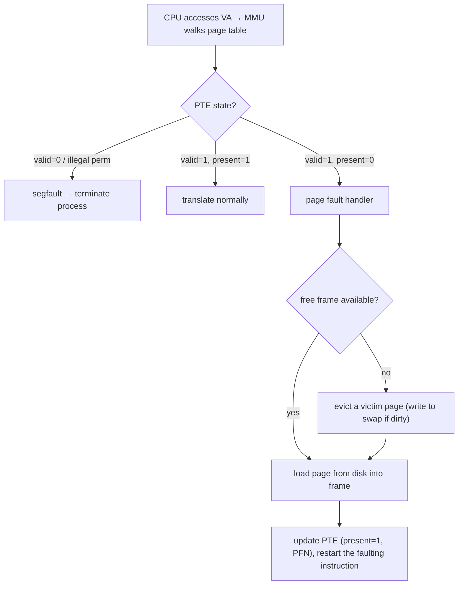

# 14 · Demand Paging

> **In one line:** don't keep every page in RAM — give a page a physical frame only when it's **touched** (a
> **page fault** brings it in, evicting a victim to **swap** if RAM is full), which lets the OS **overcommit**
> memory; the risk is **thrashing**, and the key knob is the **page-replacement policy** (approximate LRU).

Prereqs: [[13 - Paging]]. (xv6 has **no** demand paging — [[24 - xv6 Memory]].)

---

## 1. The idea: virtual memory bigger than physical

Must all pages of all processes be in RAM at once? **No** — a process doesn't use all its memory at once, and
total virtual memory can exceed physical RAM. So the OS provides **virtual memory via demand paging**:

- Some pages are **not valid** (never allocated).
- Of the valid pages: some are **present** in a RAM frame; others are **swapped out** to disk, brought in **on
  demand** when accessed.

This lets the OS **overcommit**: promise more memory than physically exists, betting not all of it is needed at
once. (xv6 keeps it simple — no demand paging; everything valid is resident.)

## 2. Swap space and the two PTE bits

**Swap space** = a dedicated area on **disk** holding pages that don't fit in RAM. A valid page is tracked by the
page table as **either** a physical frame number (in RAM) **or** a disk/swap address (swapped out).

Two PTE bits tell them apart ([[13 - Paging]] §3):

| Valid | Present | Meaning |
|---|---|---|
| 0 | – | page not in use → access = **segfault** |
| 1 | 1 | valid **and in RAM** → translate normally |
| 1 | 0 | valid but **on disk (swapped out)** → access triggers a page fault to swap it in |

## 3. The page fault

When the MMU walks the page table it inspects these bits and **traps to the OS (page fault)** on anything
unexpected. The handler:

- **valid=0** or illegal access (e.g. writing a read-only page) → **segmentation fault**, terminate the process.
- **valid=1, present=0** → allocate a free frame, bring the page in from disk, update the PTE, and **restart the
  faulting instruction** (which now succeeds).

## 4. Reclaiming memory: eviction and page types

If there's **no free frame**, the OS must **evict a victim** to swap to free a frame:

1. Pick a victim (per the **replacement policy**, §6). It may belong to another process.
2. If the victim is **dirty**, write it to swap first; if clean, just drop it (the disk copy is still valid).
3. Load the faulting page into the freed frame, fix both PTEs, restart.

**Page types determine the disk work:**
- **File-backed** (e.g. code pages, from an executable/library) vs **anonymous** (stack/heap, not from a file).
- **Dirty** (modified since loaded) vs **clean**.

Rules that fall out:
- **Evicting:** write to swap **only if dirty**; a clean page can be discarded and refetched from disk later
  (its backing copy is unchanged). → prefer evicting **clean** pages (no write).
- **Faulting in:** a file-backed or non-empty anonymous page must be **initialized from disk**; a brand-new,
  never-used anonymous page can just get a **zeroed frame** (no disk read).
- A single page fault may block the process for **multiple disk I/Os** (write victim + read new page). Average
  memory access time balloons if faults are frequent.

## 5. Thrashing and the working set

- A process's **working set** = the set of pages it uses frequently in a given phase. It changes over time and is
  usually **much smaller** than the whole virtual memory.
- If the OS gives a process **less** RAM than its working set → **constant page faults**.
- **Thrashing**: the system spends most of its time swapping pages in/out and almost none doing useful work —
  severe, user-visible slowdown. Happens when the total working set of all processes exceeds RAM.
- **Fixes:** reduce each process's working set, kill/suspend some processes, free unneeded memory, or add RAM.

> Page faults are the most dangerous source of slowdown (vs cache/TLB misses) because each may involve **disk**
> access (~ms) — ~10,000× a RAM access ([[01 - Computer Architecture Background]]).

## 6. Page-replacement policies

Which victim to evict? Goal: evict the page **least likely to be used soon**, to minimize future faults.

| Policy | Rule | Notes |
|---|---|---|
| **Optimal (MIN)** | evict the page needed **furthest in the future** | provably best, but needs the future → **impractical**, a benchmark only |
| **FIFO** | evict the oldest-loaded page | simple; can evict a hot page → more faults; suffers **Belády's anomaly** (more frames can give *more* faults) |
| **LRU** | evict the **least-recently-used** page | works well due to **locality** (recently used ⇒ likely used again); approximates optimal in practice |

**The LRU implementation problem:** true LRU needs to know the exact last-use time of every page — but the **OS
isn't involved in every memory access** (the MMU is), so it can't track that directly.

**Approximate LRU (the clock algorithm idea):**
- The **MMU sets the "accessed" bit** in a PTE whenever it uses that page.
- The OS **periodically scans** accessed bits to classify pages as **active** (bit set recently) or **inactive**,
  clearing the bits as it goes.
- It evicts from the **inactive** set, and prefers **clean** pages (avoid the extra swap write for dirty ones).

This gives LRU-like behavior without per-access tracking — what real OSes actually do.

---

## Interview questions

> [!question] Q1. What is demand paging and why do it?
> Allocate a physical frame to a page only when it's first accessed, keeping the rest on disk/swap. It lets a
> process's (and the system's) virtual memory exceed physical RAM (**overcommit**), and avoids loading pages that
> are never used. The cost is page faults when a needed page isn't resident.

> [!question] Q2. Walk through a page fault.
> MMU walks the page table and finds valid=1, present=0 → traps to the OS. The handler finds a free frame (or
> **evicts a victim**, writing it to swap if dirty), reads the faulting page from disk into the frame, updates the
> PTE (present=1, new PFN), and **restarts the faulting instruction**, which now succeeds. An invalid/illegal
> access instead causes a segfault.

> [!question] Q3. What do the valid and present bits mean together?
> valid=0 → page unused (access = segfault). valid=1, present=1 → in RAM, translate normally. valid=1, present=0 →
> valid but swapped to disk → page fault brings it in. Valid = "is this a real page of the process"; present =
> "is it currently in a RAM frame."

> [!question] Q4. When evicting, when must you write the page to disk?
> Only if it's **dirty** (modified since load). A clean page has an identical copy already on disk (file-backed) or
> in swap, so it can be discarded and refetched — no write needed. So the OS prefers evicting clean pages.

> [!question] Q5. What is thrashing and how do you fix it?
> When the combined working sets exceed RAM, the system spends almost all its time swapping pages in/out instead
> of doing work → drastic slowdown. Fixes: reduce working sets, suspend or kill some processes, free memory, or
> add RAM.

> [!question] Q6. Why is true LRU hard to implement, and what's done instead?
> True LRU needs the last-access time of every page, but the OS doesn't see every access (the MMU does). Instead,
> the MMU sets an **accessed bit** per PTE; the OS periodically scans and clears these bits to approximate LRU
> (active/inactive lists, clock algorithm), evicting inactive, preferably clean, pages.

> [!question] Q7. What is Belády's anomaly?
> With **FIFO** replacement, giving a process **more** frames can sometimes **increase** the number of page faults
> — counterintuitive and a reason FIFO is avoided. LRU and optimal don't suffer it (they're "stack algorithms").

## Five things to remember
1. **Demand paging** = bring a page into RAM only when touched; enables **overcommit** (virtual > physical memory).
2. A valid page is either **present** (in a frame) or **swapped** (on disk); the **valid/present** PTE bits distinguish them.
3. A **page fault** (valid=1, present=0) allocates a frame — **evicting a victim to swap** if RAM is full — then restarts the instruction.
4. Write a victim to swap **only if dirty**; new anonymous pages just get a **zeroed** frame. Too many faults → **thrashing** (working set > RAM).
5. Replacement: **Optimal** (ideal), **FIFO** (simple, Belády's anomaly), **LRU** (locality-based, best practical) — real OSes use **approximate LRU** via the accessed bit.
