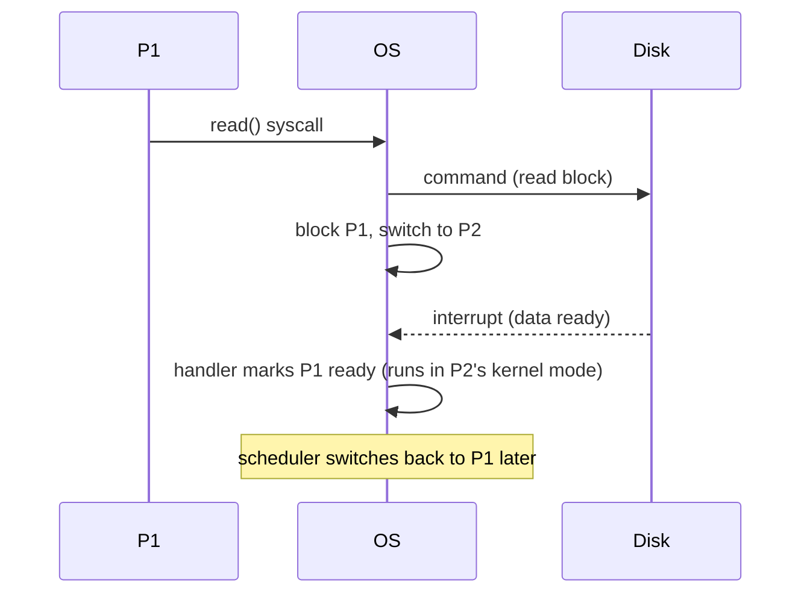

# 15 · I/O Devices

> **In one line:** the OS talks to a device through its **controller's registers** (via port I/O or
> memory-mapped I/O); the efficiency ladder is **polling → interrupts → DMA**, each removing a way the CPU
> wastes cycles waiting on slow hardware.

Prereqs: [[00 - OS Introduction]] (interrupts), [[04 - Trap Handling and Context Switching]]. Next: [[16 - Files]], [[17 - Filesystems]].

---

## 1. How devices connect

CPU and memory sit on a fast **system/memory bus**; I/O devices hang off separate buses (PCIe, USB, SATA, …),
connecting at a **port**. A **bus** is just a set of wires carrying signals; faster buses are closer to the CPU.

**Two device classes:**
- **Block devices** — store/serve fixed-size numbered **blocks** (disks, SSDs; block ≈ 512 B). Random-addressable.
- **Character devices** — produce/consume a **stream of bytes** (keyboard, serial port). Sequential.

## 2. The device interface: registers

A device is managed by a **controller** that exposes a small set of **registers**, hiding the device internals:
- **Status** — is the device busy / ready / error?
- **Command** — what operation to perform (read, write, …).
- **Data** — the bytes to transfer.

The OS code that drives a specific device — reading/writing these registers, handling its interrupts — is the
**device driver**. The rest of the OS is written against a clean abstraction, so device-specific mess stays in the
driver ([[00 - OS Introduction]] §9).

**Two ways to access the registers:**
- **Port I/O (explicit I/O instructions):** special privileged instructions (x86 `in`/`out`) read/write a
  device's register addresses. Only the OS (kernel mode) can run them.
- **Memory-mapped I/O (MMIO):** the device's registers appear as ordinary **memory addresses**; the OS just does
  loads/stores, and the memory hardware routes those special addresses to the device. Cleaner and dominant today.

## 3. The efficiency ladder

### (a) Polling — the naive way
```
give command → loop: read status register until "ready" → transfer data
```
Simple, but the CPU **busy-waits** on the status register, wasting cycles while a slow device works.

### (b) Interrupts — stop waiting, go do other work
Instead of polling, the OS **blocks** the requesting process and context-switches to another. When the device
finishes, it **raises an interrupt**; the CPU traps into the OS **interrupt handler** (located via the **IDT**,
indexed by the device's **IRQ number** — see [[04 - Trap Handling and Context Switching]]), which unblocks the
waiting process and kicks off any pending I/O.



> [!note] Interrupts aren't always better
> Each interrupt costs a kernel-mode transition. For a **very fast** device (e.g. fast SSD/NIC), **polling can
> beat interrupts** — you'd finish before the interrupt overhead pays off. Real systems use **hybrids** (e.g.
> Linux NAPI: interrupt, then poll a batch — see [[19 - Network IO in Linux]]).

### (c) DMA — stop the CPU from copying bytes
Even with interrupts, the CPU still wastes cycles **copying data** between the device and RAM. **Direct Memory
Access (DMA)** is a hardware engine that moves data between RAM and the device **without the CPU**:
- CPU gives the DMA engine the memory location; the device DMAs the data into/out of RAM directly, then raises
  **one** interrupt when the whole transfer is done.

## 4. Putting it together: a disk read with interrupts + DMA

```
1. P1 calls read()  → trap into OS
2. OS issues the read command to the disk controller
3. OS blocks P1 and switches to P2 (P1 can't proceed)
4. Disk reads the data and DMAs it straight into RAM (no CPU copy)
5. Disk raises an interrupt → OS handler (runs in P2's kernel mode) marks P1 ready
6. Scheduler switches back to P1 later; read() returns
```

This is the canonical "slow I/O overlapped with useful work" pattern: **block the waiter, DMA the data, interrupt
on completion, reschedule.**

## 5. The I/O stack

The OS builds I/O as **layers** so device-specific detail is isolated:
```
 system calls (read/write/open)
        │
 I/O subsystem (file system / network stack)   ← device-independent
        │
 block layer / generic driver interface
        │
 device driver (device-specific: commands, interrupts)
        │
 device controller → device
```

---

## Interview questions

> [!question] Q1. How does the OS communicate with a device?
> Through the device's **controller registers** (status/command/data), accessed either via **port I/O** (special
> privileged instructions like x86 `in`/`out`) or **memory-mapped I/O** (registers appear as memory addresses; the
> OS just does loads/stores). The device-specific code is the **driver**.

> [!question] Q2. Polling vs interrupts — trade-off?
> Polling busy-waits on the status register (wastes CPU, but no per-event overhead and low latency). Interrupts
> let the OS block the waiter and do other work, but each interrupt costs a kernel transition. Interrupts win for
> slow devices; **polling can win for very fast devices**; hybrids (NAPI) combine them.

> [!question] Q3. What does DMA do and why does it matter?
> A DMA engine transfers data between device and RAM **without the CPU** copying each byte, raising a single
> interrupt on completion. It frees the CPU from the data-movement bottleneck for large transfers — essential for
> disks and NICs.

> [!question] Q4. Block vs character devices?
> Block devices expose fixed-size, randomly addressable numbered blocks (disks, SSDs); character devices expose a
> sequential byte stream (keyboard, serial). File systems sit on block devices.

> [!question] Q5. Trace a disk read end to end.
> `read()` traps into the OS; OS commands the disk and **blocks** the process, switching to another; the disk
> **DMAs** the data into RAM and raises an **interrupt**; the handler marks the process ready; the scheduler
> resumes it and `read()` returns. The CPU does useful work the whole time the disk is seeking/transferring.

## Five things to remember
1. OS ↔ device via **controller registers** (status/command/data), accessed by **port I/O** or **memory-mapped I/O**; the **driver** holds device-specifics.
2. **Polling** busy-waits (wastes CPU); **interrupts** let the CPU work meanwhile but cost a kernel transition.
3. **DMA** moves data device↔RAM without the CPU, one interrupt at the end — vital for large transfers.
4. Canonical slow-I/O pattern: **block the waiter → DMA → interrupt on done → reschedule**.
5. For very fast devices, **polling can beat interrupts**; real systems use **hybrids** (e.g. NAPI).
