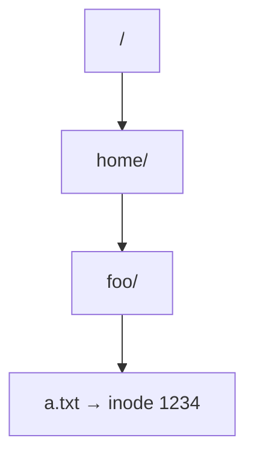

# 16 · Files

> **In one line:** a **file** is a named sequence of bytes on disk; you access it through a **file descriptor**
> (an integer handle into your per-process fd table); directories are special files mapping **names → inode
> numbers**; and "everything is a file" because sockets and pipes use the same fd + read/write interface.

Prereqs: [[15 - IO Devices]], [[03 - Process System Calls]] (fds), [[10 - Inter-Process Communication]]. Next: [[17 - Filesystems]] (how it's all implemented on disk).

---

## 1. The file abstraction

- A **file** = a sequence of bytes stored persistently on disk.
- A **directory** = a container for files and sub-directories.
- A **filesystem** = the OS subsystem that stores files/directories persistently on secondary storage, exposing
  file syscalls to users.

Disks expose fixed-size **blocks** (~512 B); the filesystem organizes files onto blocks and translates
`read`/`write` syscalls into block reads/writes ([[17 - Filesystems]]).

## 2. The access pattern: open → read/write → close

```c
int fd = open("/home/foo/a.txt", flags);  // get a handle (file descriptor)
char buf[64];
int n = read(fd, buf, 64);                 // read up to 64 bytes, returns #read
       write(fd, buf, 64);                 // write 64 bytes, returns #written
       close(fd);                          // done
```

- A **file descriptor (fd)** is a small integer handle to the open file; you pass it to every subsequent call.
- `read`/`write` transfer *N* bytes to/from a user buffer and **return the actual count** (may be less than
  requested, e.g. at end of file).

## 3. The file offset

Each open file has a **current offset**. `read`/`write` advance it: after reading N bytes, the next `read`
continues from there (streaming). `lseek` repositions it explicitly.

> [!important] Each `open` is an independent stream
> Opening the same file twice gives **two** fds with **independent offsets** — reading through one doesn't move
> the other. (The exception: fds **shared via `fork`/`dup2`** share one offset — see [[17 - Filesystems]] §6.)

## 4. Everything is a file

`open`ing a file returns an fd; so does creating a **socket** or **pipe**. Every process has an **array of file
descriptors** (part of its PCB):

```
 fd 0 → STDIN
 fd 1 → STDOUT
 fd 2 → STDERR
 fd 3 → an open file / socket / pipe …
```

Because files, sockets, and pipes all present the **same fd + `read`/`write` interface**, the same code and the
same redirection/pipe tricks ([[03 - Process System Calls]] §6) work across all of them. That uniformity is the
Unix "everything is a file" philosophy.

## 5. Directories map names to inodes

Every file is identified inside the filesystem by a unique **inode number**. A **directory** is a *special file*
whose data is a table of **(filename → inode number)** entries (plus a type tag: file vs directory).

- Directories are accessed like files (`open`/`read`/`close`) — e.g. `ls` just opens a directory and reads its
  entries.
- Files/directories form a **tree** rooted at `/`.



## 6. Hard links vs soft links

- **Hard link**: another directory entry pointing at the **same inode number** (same underlying data). The inode
  keeps a **link count**; the data is deleted only when the count hits **0**. So you `unlink` a name, and the OS
  decides when to actually free the data. Delete one hard link → the data is still reachable via the others.
- **Soft (symbolic) link**: a file whose contents are just a **pathname** pointing at another file. If the target
  is deleted, the symlink becomes a **dangling reference** (points at nothing). Can cross filesystems; hard links
  cannot.

```
hard link:  name1 ─┐
            name2 ─┴─► inode 1234 ─► data   (link count = 2)

soft link:  link ─► "/home/foo/a.txt"  ─► (resolve the path) ─► inode 1234
```

## 7. Mounting

**Mounting** attaches a filesystem (on some device) at a point in the directory tree, so its files appear under
that path. A typical machine has several devices/filesystems mounted (`mount` command) — e.g. a USB drive
appears under `/mnt/usb`.

---

## Interview questions

> [!question] Q1. What is a file descriptor?
> A small non-negative integer that indexes a process's file-descriptor table (in its PCB); it's an opaque handle
> to an open file, socket, or pipe. `open`/`socket`/`pipe` return one; `read`/`write`/`close` take one. 0/1/2 are
> STDIN/STDOUT/STDERR by default.

> [!question] Q2. If you `open` the same file twice, do the two fds share a read position?
> No — two separate `open` calls create independent streams with independent offsets. (Sharing of an offset
> happens only when an fd is duplicated, via `fork` or `dup2`, because then both fds point to the *same* open-file
> table entry.)

> [!question] Q3. Hard link vs soft link?
> A hard link is another name for the **same inode** (same data); the inode's link count tracks names, and data is
> freed only at count 0 — so deleting one name leaves the data reachable. A soft/symbolic link is a file
> containing a **pathname** to another file; deleting the target leaves a dangling link. Soft links can cross
> filesystems and point to directories; hard links generally can't.

> [!question] Q4. What is a directory, really?
> A special file whose data is a table of (filename → inode number) entries. The inode's type field marks it as a
> directory. Programs like `ls` read it like any file; lookups search this table for a name to get its inode
> number.

> [!question] Q5. What does "everything is a file" mean and why is it useful?
> Files, directories, pipes, sockets, and many devices are all accessed through the same fd + `read`/`write`/`close`
> interface. This uniformity means generic tools, I/O redirection, and pipelines work across all of them without
> special-casing, and programs can be composed easily.

## Five things to remember
1. A **file** = persistent byte sequence; accessed via **open → read/write → close** using a **file descriptor**.
2. Each open file has an **offset** that `read`/`write` advance; separate `open`s have **independent** offsets.
3. **Everything is a file**: sockets/pipes also use fds + `read`/`write`; fds 0/1/2 = STDIN/OUT/ERR.
4. A **directory** is a special file mapping **names → inode numbers**; files form a tree rooted at `/`.
5. **Hard link** = extra name for the same inode (link count; data freed at 0); **soft link** = a file holding a pathname (can dangle).
