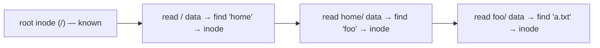
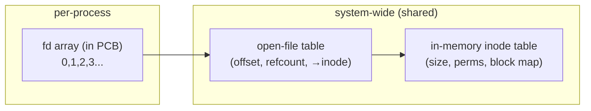

# 17 · Filesystems

> **In one line:** a filesystem lays a file's blocks out on disk and tracks them in an **inode** (like a page
> table for a file), with directories mapping names→inodes; **pathname lookup** walks inodes from `/`; open files
> are tracked by the **fd table → open-file table → inode** chain; and crashes are survived with **journaling**.

Prereqs: [[16 - Files]], [[15 - IO Devices]], [[13 - Paging]] (the inode/page-table analogy). Real code: xv6 filesystem.

---

## 1. On-disk layout

A file is variable-sized, split into fixed-size **blocks** stored **non-contiguously** (fixed blocks avoid
external fragmentation — exactly like paging splits memory into frames, [[13 - Paging]]). Formatting a disk lays
down this structure:

```
┌──────────┬──────────┬───────────────┬──────────────────────────────┐
│superblock│ bitmaps  │ inode blocks  │        data blocks            │
└──────────┴──────────┴───────────────┴──────────────────────────────┘
```
- **Superblock** — the master plan: where the inode blocks, data blocks, etc. are.
- **Bitmaps (free lists)** — which inodes / data blocks are free vs used.
- **Inode blocks** — an array of inodes (one per file).
- **Data blocks** — the actual file contents.

## 2. The inode

For every file, the **inode** (index node) stores all **metadata** + the **disk block numbers** of the file's
data:
- metadata: size, permissions, owner, timestamps, type (regular file vs directory), **link count**;
- the locations (block numbers) of the file's data blocks.

> The inode is to a file what the **page table** is to a process's memory: a map from logical position → physical
> location on disk. A file's **inode number** is its index into the on-disk inode array, and it **uniquely
> identifies** the file.

### Multi-level block pointers (handling any file size)
An inode stores block numbers **hierarchically** so small files are cheap and huge files are still possible:
```
inode:
  ├─ direct block ptrs      → first K data blocks        (small files: instant)
  ├─ single-indirect ptr    → a block of N block numbers
  ├─ double-indirect ptr    → a block of N single-indirect blocks
  └─ triple-indirect ptr    → a block of N double-indirect blocks
```
- **Asymmetric on purpose**: most files are small, so the first few blocks are reachable directly (no extra disk
  reads); only big files pay for indirection.
- **Max file size** = `K + N + N² + N³` blocks (direct + single + double + triple). Filesystem metadata thus caps
  max file size, max number of files, and max disk size — and these limits differ per filesystem.

## 3. Directories and pathname lookup

A **directory** is a special file whose data blocks hold **(filename → inode number)** records (as arrays, linked
lists, or hash trees). Looking up a name = fetch the directory's inode → read its data blocks → search for the
name → get its inode number.

**Pathname resolution** (`/home/foo/a.txt`): start at the **well-known root inode** and walk down, one component
at a time:

Each step costs disk reads (the directory's inode + its data blocks), so deep paths are several disk accesses —
another reason for caching.

## 4. `open`, and why you open before use

`open` does the pathname walk **once** and caches the file's inode **in memory**, so later `read`/`write` have
the block map instantly:
1. Traverse the pathname from root → find the file's inode number (allocate a **new inode + directory entry** via
   the bitmap if creating a new file).
2. Copy the inode into memory (if not already cached).
3. Create an **open-file table entry** pointing at the in-memory inode.
4. Allocate a free slot in the process's **fd array** pointing at that open-file entry; return the index.

`close` tears down the fd and open-file entries.

## 5. The three in-memory structures (know this diagram cold)



- **fd array** — per process (in the PCB); the fd integer indexes it.
- **open-file table** — system-wide; **one entry per `open` call**, holding the **offset**, a **refcount**, and a
  pointer to the inode. (Sockets/pipes get entries here too.)
- **in-memory inode table** — system-wide; the cached inodes.

Why the middle layer exists — it's where the **offset** lives, and it enables sharing:

- **Same file `open`ed twice** → **two** open-file entries (independent offsets) → both point at the **one** cached
  inode. (This is [[16 - Files]] §3.)
- **After `fork`** → the child's fd array is a **copy** of the parent's, but entries point at the **same**
  open-file entries → parent and child **share the offset** (refcount bumped). Usually one should close.
- **`dup2`** makes one fd an alias of another (both point at the same open-file entry) → used for I/O
  **redirection** (make STDOUT's fd point at a file's open-file entry). A **refcount** tracks how many fds point
  at each open-file entry; it's freed at 0.

## 6. The disk buffer cache

Disk data read from disk is kept in RAM in the **disk buffer cache** (unused physical memory is given to it).
Writes modify the cached copy first, then hit disk:
- **Write-through**: write to disk **immediately** (synchronous) — safe, slower.
- **Write-back**: write to disk **later** (asynchronous) — faster, but **data loss on power failure**.

Benefits: far fewer disk accesses (the ~10⁴× DRAM↔disk gap), and merging of multiple processes' writes to the
same blocks.

**A `read` syscall, with the cache:** fd → open-file entry → inode → which data block(s) (from the offset) →
check buffer cache → on **miss**, driver commands the disk, process **blocks**, disk **DMAs** the block into the
cache and **interrupts**, process becomes ready → copy the requested bytes from the cached block into the user
buffer → return count. A `write` is symmetric, allocating new blocks (updating bitmap + inode) if extending the
file, and marking the cached block **dirty**.

## 7. `mmap` a file (alternative to read/write)

Instead of `read`/`write`, map the file into the address space: `mmap(fd, ...)` returns a virtual address; file
blocks are read into physical frames mapped into your address space (on demand, via page faults — [[14 - Demand
Paging]]). Access it like memory.
- **Shared** mode: changes go to disk and are visible to others. **Private** mode: changes are private
  (copy-on-write), flushed on unmap.
- **Avoids an extra copy**: `read` copies disk→kernel buffer→user buffer; `mmap` maps the frame straight into
  your address space (how executables/shared libraries are loaded). Great for large/bulk access, poor for tiny
  scattered reads.

## 8. Crash consistency and journaling

**The problem:** one syscall updates **multiple** disk blocks (append = data block + inode + bitmap). All happen
in the buffer cache first. A **power failure mid-syscall** can leave the disk **partially** updated → an
inconsistent filesystem:
- data block written but not linked from the inode → silently **lost data**;
- inode points at a block whose contents weren't written → **garbage** in the file;
- bitmap marks a block used but no inode references it → leaked block.

What we want is **atomicity**: all of a syscall's changes happen, or none do.

**Two approaches:**
- **fsck (filesystem checker):** after a crash, scan metadata and repair inconsistencies (e.g. a block marked
  used but unreferenced → mark free). Rule of thumb: write **data before metadata** (losing data beats dangling
  garbage). But fsck is slow and can't fix everything, especially with multiple metadata blocks.
- **Journaling / logging (the standard fix):**
  ```
  1. write all intended changes to an on-disk LOG (originals untouched)
  2. write a COMMIT record to the log
  3. apply the changes to the real blocks; then clear the log
  ```
  - Crash **before commit** → log is incomplete → ignore it → it's as if the syscall never happened.
  - Crash **after commit, before apply** → **replay** the log on reboot to finish the changes.
  Either way the filesystem is consistent. (This is the same write-ahead-log idea as databases and your Micro
  Exchange's WAL.)

## 9. VFS — the Virtual File System layer

Different filesystems implement syscalls differently (journaling vs not; array vs linked-list directories). To
keep the OS modular, the **VFS** defines a common set of **objects** (file, directory, inode) and **operations**
(open, lookup, read…); each concrete filesystem provides function pointers implementing them. The OS calls
through the VFS, so filesystems are pluggable:
```
system call → VFS → specific filesystem impl → disk buffer cache → device driver
```

---

## Interview questions

> [!question] Q1. What is an inode and what does it store?
> A per-file structure holding the file's **metadata** (size, permissions, timestamps, type, link count) and the
> **disk block numbers** of its data. Its index in the on-disk inode array is the file's **inode number**, which
> uniquely identifies it. It's analogous to a page table mapping logical→physical.

> [!question] Q2. How does an inode handle both tiny and huge files efficiently?
> Multi-level block pointers: a few **direct** pointers (small files reached with no indirection), then
> **single/double/triple-indirect** blocks for larger files. Max size ≈ K + N + N² + N³ blocks. Small files (the
> common case) stay cheap; only large files pay for indirection and extra disk reads.

> [!question] Q3. Walk through opening `/home/foo/a.txt`.
> Start at the known root inode; read `/`'s data to find `home`'s inode; read `home`'s data to find `foo`'s inode;
> read `foo`'s data to find `a.txt`'s inode. Cache that inode in memory, create an open-file table entry (offset,
> refcount, →inode), put a pointer to it in the process's fd array, return the fd. Later reads/writes use the
> cached inode directly.

> [!question] Q4. Explain the fd table / open-file table / inode table split. Why three levels?
> The **fd array** is per-process (fd integer → open-file entry). The **open-file table** is system-wide, one
> entry per `open`, holding the **offset** and a refcount. The **inode table** caches inodes. The middle layer
> holds the offset and enables sharing semantics: two `open`s of one file → two offsets, one inode; `fork`/`dup2`
> → multiple fds sharing one offset (one open-file entry). Redirection works by pointing an fd at another's
> open-file entry.

> [!question] Q5. Write-through vs write-back cache?
> Write-through flushes each write to disk immediately — durable but slow. Write-back defers writes (batches/merges
> them) — much faster but risks losing recently-written data on a power failure. Most systems default to write-back
> with periodic flushing.

> [!question] Q6. What is crash consistency and how does journaling solve it?
> A single syscall updates several blocks; a crash mid-way can leave the disk inconsistent. Journaling first writes
> all intended changes to an on-disk **log**, writes a **commit** record, then applies them to the real blocks. A
> crash before commit → discard the log (no change); after commit → replay the log to finish. This gives atomicity
> (all-or-nothing).

> [!question] Q7. Why mmap a file instead of read/write?
> `mmap` maps file blocks directly into the address space, so you access the file as memory and **avoid the extra
> kernel→user copy** that `read` does; with demand paging, frames load lazily. It's how executables/libraries load
> and is efficient for large/bulk access, but inefficient for many small scattered reads.

> [!question] Q8. What is the VFS and why does it exist?
> A layer defining common file/directory/inode objects and operations; each filesystem plugs in by providing
> function implementations. It lets the kernel support many filesystems through one interface and switch/add them
> without changing syscall code.

## Five things to remember
1. On disk: **superblock + bitmaps + inodes + data blocks**; files are fixed-size blocks stored non-contiguously (no external fragmentation).
2. The **inode** = a file's metadata + block map (like a page table); **direct + single/double/triple-indirect** pointers handle any size; **directories map names→inode numbers**; lookup walks inodes from `/`.
3. Open-file chain: **per-process fd array → system-wide open-file table (offset, refcount) → in-memory inode table**; this split explains `fork`/`dup2` offset sharing and redirection.
4. The **disk buffer cache** (write-through vs write-back) hides the DRAM↔disk gap; reads/writes go through it with DMA + interrupts.
5. A syscall touches **multiple blocks** → crashes risk inconsistency → **journaling** (log → commit → apply, replay on reboot) gives atomicity; **VFS** makes filesystems pluggable.
