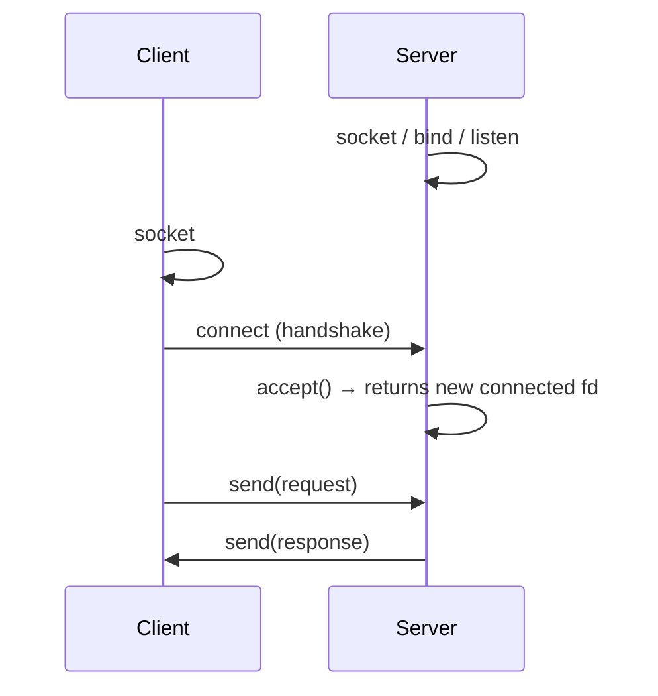

# 18 · Network I/O via Sockets

> **In one line:** a **socket** is the endpoint abstraction for talking between processes (same machine or across
> the network); the server does **socket→bind→listen→accept**, the client does **socket→connect**, and the big
> architectural choice for handling many clients is **thread-per-connection (blocking)** vs **event-driven
> (`epoll`)**.

Prereqs: [[10 - Inter-Process Communication]] (sockets as IPC, fds), [[16 - Files]]. Implementation: [[19 - Network IO in Linux]].

---

## 1. Sockets and their flavors

A **socket** is an abstraction to communicate between two processes; a pair of sockets gets connected and the two
sides read/write bidirectionally. Processes may be on the **same machine or different machines**.

Two independent axes:

| Axis | Options |
|---|---|
| **Scope** | **Unix domain** (local, same machine, named by a **pathname**) vs **Internet** (across machines, named by **IP + 16-bit port**) |
| **Connection** | **Connection-oriented** (one client ↔ one server, explicit connection) vs **connectionless** (one socket ↔ many, address per message) |

Internet + connection-oriented = **TCP** (reliable, in-order byte stream). Internet + connectionless = **UDP**
(no reliability, discrete datagrams). The type is chosen in the `socket()` call's arguments.

**Client vs server** isn't a socket type — it's *who starts first*: the **server** binds a **well-known address**
and waits; the **client** connects to that address.

## 2. Creating a socket

```c
int sockfd = socket(domain, type, ...);   // returns a socket fd (like a file descriptor)
bind(sockfd, address);                     // attach to an address
close(sockfd);                             // when done
```
- A socket fd is just like a file descriptor — an index into the process's fd array ([[16 - Files]]).
- **Servers must `bind`** to a well-known address so clients can find them. **Clients usually don't** — the OS
  assigns a temporary address.

## 3. Connectionless (UDP-style) exchange

No connection setup; put the destination address on each message:
```c
// client                                    // server
sockfd = socket(...);                          sockfd = socket(...);
sendto(sockfd, msg, server_addr, ...);         bind(sockfd, server_addr);
                                               recvfrom(sockfd, msg, client_addr, ...);
```
`recvfrom` also fills in the **sender's address**, so the server can reply. One socket can talk to many peers.

## 4. Connection-oriented (TCP-style) exchange

Explicit connection before data:
```c
// server                                     // client
sockfd = socket(...);                           sockfd = socket(...);
bind(sockfd, server_addr);
listen(sockfd, backlog);     // mark as accepting connections
newfd = accept(sockfd, ...); // BLOCKS until a client connects;  connect(sockfd, server_addr); // BLOCKS until connected
                             // returns a NEW fd for this client
recv(newfd, req, ...);                          send(sockfd, req, ...);
send(newfd, resp, ...);                         recv(sockfd, resp, ...);
```



> [!important] One listen socket, one connected socket per client
> `accept()` returns a **brand-new socket fd** dedicated to that one client. The original **listen socket** keeps
> accepting *new* connections. So a server juggles **1 listen fd + N connected fds** (one per client). This is the
> single most-tested socket fact.

`send`/`recv` are like `write`/`read` on a connected socket (no per-message address needed), plus a `flags`
argument controlling blocking and other behavior.

## 5. Handling many clients concurrently

A single thread doing `accept`/`recv` **blocks** — while blocked on one client it ignores all others. Two
architectures solve this:

### (a) Thread/process per connection (blocking API)
```
main thread: loop { newfd = accept(listenfd); spawn worker(newfd); }
worker:      loop { recv(newfd); process; send(newfd); }
```
- Simple to write (each worker is straight-line blocking code).
- **Doesn't scale to very many clients** — processes/threads are limited (memory, scheduling overhead). ~10⁴
  threads is a lot; the "C10K problem" is exactly this wall.

### (b) Event-driven / asynchronous (`epoll`)
One thread monitors **many** fds and only acts on the ones that are **ready**:
```c
int epfd = epoll_create(...);
epoll_ctl(epfd, EPOLL_CTL_ADD, listenfd);  // watch fds of interest
while (1) {
    ready = epoll_wait(epfd, ...);          // blocks until ANY watched fd is ready
    for (fd in ready) handle(fd);            // accept / recv / send — must NOT block
    // register any new fds
}
```
- The OS monitors all fds; `epoll_wait` returns the ready set. **One thread handles thousands of clients.**
- **Rule: never do a blocking operation inside an event handler** — one blocking call stalls *all* clients.
- Lower overhead, higher throughput, but **harder to program** and **harder to scale across cores** (one event
  loop is single-threaded; you run one loop per core).
- `select` is the old, limited version; `epoll` (Linux) scales to many fds. (Node.js, nginx, Redis all use this
  model.)

> [!note] The trade-off in one line
> **Thread-per-connection**: easy code, limited scale. **Event-driven**: high scale/throughput, trickier code and
> single-core per loop. Real high-performance servers use event loops (often one per core). RPC libraries wrap
> the raw socket API to make remote calls look like function calls.

---

## Interview questions

> [!question] Q1. Walk through the server and client socket calls for TCP.
> Server: `socket` → `bind`(well-known addr) → `listen` → `accept` (blocks, returns a new per-client fd) →
> `recv`/`send` on that fd. Client: `socket` → `connect`(server addr) (blocks through the handshake) →
> `send`/`recv`. The listen socket keeps accepting; each client gets its own connected socket.

> [!question] Q2. What does `accept` return and why is that important?
> A **new** socket fd bound to that specific client connection. The original listen socket is untouched and keeps
> accepting new clients. So a server has one listen fd plus one connected fd per client — essential for handling
> multiple clients.

> [!question] Q3. TCP vs UDP sockets at the API level?
> TCP = connection-oriented: `listen`/`accept`/`connect`, then `send`/`recv` on a connected socket (reliable,
> in-order byte stream). UDP = connectionless: no connection; `sendto`/`recvfrom` carry the peer address per
> message (no reliability, discrete datagrams, one socket to many peers).

> [!question] Q4. How do you handle 10,000 concurrent clients?
> Not with 10,000 threads (too much memory/scheduling overhead — the C10K problem). Use an **event-driven** model:
> `epoll` monitors all fds; a single thread loops on `epoll_wait` and services only ready fds, never blocking in a
> handler. Scale across cores by running one event loop per core.

> [!question] Q5. Why must you never block inside an epoll event handler?
> Because the single event-loop thread serves all clients; a blocking call (e.g. a slow disk read or `recv` on an
> empty socket) freezes every other client until it returns. All operations in an event-driven server must be
> non-blocking/async.

> [!question] Q6. Thread-per-connection vs event-driven — trade-offs?
> Thread-per-connection: simple blocking code, natural multicore use, but limited by thread count and
> context-switch overhead. Event-driven: handles far more connections with less overhead and memory, but is harder
> to write (no blocking, callback-structured) and a single loop is single-core (run N loops for N cores).

## Five things to remember
1. A **socket** connects two processes (local via Unix-domain/pathname, remote via Internet/IP+port); TCP = connection-oriented, UDP = connectionless.
2. Server: **socket→bind→listen→accept**; client: **socket→connect**. A socket fd is just a file descriptor.
3. **`accept` returns a new fd per client**; the listen socket keeps accepting → server has 1 listen + N connected fds.
4. Scaling choice: **thread-per-connection** (simple, limited) vs **event-driven `epoll`** (one thread, many clients, high throughput).
5. In an event loop, **never block in a handler**; run one loop per core to use multiple cores.
