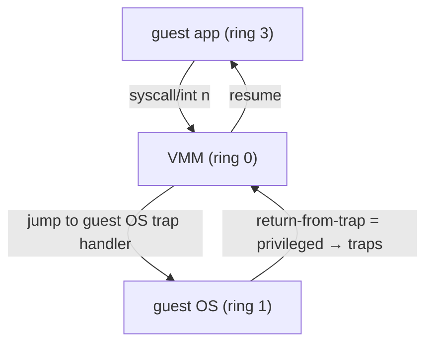

# 20 · Virtualization

> **In one line:** a **hypervisor** multiplexes many **VMs** on one machine the way an OS multiplexes processes;
> the ideal is **trap-and-emulate** (guest OS runs at low privilege, privileged ops trap to the VMM), but x86
> isn't naturally virtualizable (**Popek–Goldberg**), so we use **paravirtualization**, **binary translation**,
> or **hardware-assisted** virtualization — and **containers** are the lightweight alternative.

Prereqs: [[00 - OS Introduction]] (privilege levels), [[04 - Trap Handling and Context Switching]] (traps, IDT). Pairs with [[13 - Paging]].

---

## 1. VMs, hypervisors, and why

- **Cloud** = commodity servers (compute + storage) with fast networking in data centers.
- **Virtualization** = running multiple **virtual machines (VMs)** on one **physical machine (PM)**; each VM gives
  the illusion of a real machine. A **container** is a lighter-weight VM-like unit.
- A **hypervisor / virtual machine monitor (VMM)** is the software that lets multiple VMs share a PM — exactly
  analogous to how an OS multiplexes processes on a CPU.

```
   VM     VM     VM            process process process
  [OS]   [OS]   [OS]      vs      [ OS kernel ]
  └──── VMM ────┘                 └── hardware ──┘
   └ physical machine ┘
```

**Why cloud/virtualization?** Multiplexing gains (share one server across tenants), lower maintenance (provider
owns the hardware), flexibility (migrate a VM off a failing machine), pay-per-use. **Downsides:** network latency
to reach servers, and higher cost if used heavily.

## 2. The challenge

A guest OS *expects complete control over the hardware*, but the VMM must multiplex several guest OSes on the same
hardware without letting any of them actually control it. How do you run an OS that thinks it's in charge, when
it isn't?

## 3. Trap-and-emulate (the ideal mechanism)

CPUs have privilege rings. Normally: user app in **ring 3**, OS in **ring 0**. Under virtualization:
- Guest **app** → ring 3
- Guest **OS** → an *intermediate* ring (e.g. ring 1): more privileged than apps, but **less** than the VMM
- **VMM / host OS** → ring 0

The scheme: the guest OS runs at **lower privilege than the VMM**, so whenever it executes a **privileged
instruction** (set the IDT, set CR3/page-table base, touch hardware), it **traps to the VMM**, which **emulates**
the effect safely.


So a guest syscall traps to the VMM, which forwards it to the guest OS's handler; the guest OS's privileged
actions each trap back to the VMM to be emulated. Sensitive structures (IDT, page tables) are really managed by
the VMM, not the guest.

## 4. Why plain trap-and-emulate fails on x86

Two problems:
1. **The guest OS can tell it's been demoted.** Some x86 registers (e.g. the code-segment/CS register, reflecting
   the current ring) are readable by the guest OS — it reads them, sees it's in ring 1, and "gets offended"
   (behaves wrongly, or security assumptions break).
2. **Sensitive-but-not-privileged instructions.** Some x86 instructions change hardware state yet run in *both*
   privileged and unprivileged modes **without trapping** — they just behave *differently* in ring 1 vs ring 0.
   Example: **`popf`** pops flags into the EFLAGS register; in ring 0 it sets all flags including the privileged
   **interrupt flag (IF)**, but in ring 1 it silently **skips IF** and doesn't trap. The guest OS thinks it
   disabled interrupts; it didn't → buggy guest, no trap for the VMM to catch.

### Popek–Goldberg theorem
- **Sensitive instruction** = changes/depends on hardware state.
- **Privileged instruction** = traps if run outside ring 0.
- **A machine is efficiently virtualizable by trap-and-emulate only if every sensitive instruction is
  privileged** (so they all trap). **x86 violates this** (sensitive instructions like `popf` aren't privileged) →
  pure trap-and-emulate is impossible on classic x86.

## 5. Three ways to virtualize x86

| Technique | How | Guest OS modified? | Example |
|---|---|---|---|
| **Paravirtualization** | rewrite the guest OS to avoid privileged ops and make explicit **hypercalls** to the VMM | **yes** (needs source) | Xen |
| **Full virtualization (binary translation)** | **dynamically translate** guest instructions on the fly so sensitive ones trap/emulate correctly | no (runs unmodified OS) | VMware Workstation |
| **Hardware-assisted** | CPU adds a **VMX mode**: a whole extra set of rings for the guest; VMM enters VMX to run the guest in a *real* ring 0, exits back to the VMM on triggers | no | KVM/QEMU, Intel VT-x / AMD-V |

- **Paravirtualization**: lowest overhead, but you must modify (recompile) the guest OS — can't run a closed OS.
- **Binary translation**: works with unmodified OSes, but translation adds overhead.
- **Hardware-assisted (today's default)**: the CPU has a **VMX root mode** (for the VMM) and **VMX non-root mode**
  (for the guest), each with its own 4 rings. The guest OS runs in a genuine ring 0 (so it's not "offended" and
  sensitive instructions behave correctly); defined events cause a **VM-exit** back to the VMM, which retains
  ultimate control. This made efficient x86 virtualization practical.

## 6. Containers (worth a mention)

A **container** virtualizes at the **OS level**, not the hardware level: all containers share the **host kernel**,
isolated by kernel features (namespaces for visibility, cgroups for resource limits). No guest OS, no hypervisor
→ **much lighter** (fast startup, low overhead) than VMs, but **weaker isolation** (shared kernel = larger attack
surface) and you can't run a different OS kernel. VMs isolate more strongly; containers pack more densely. (Docker
= containers.)

---

## Interview questions

> [!question] Q1. What is a hypervisor and how is it like an OS?
> A hypervisor/VMM is software that runs multiple VMs on one physical machine, multiplexing CPU/memory/I/O among
> them. It's analogous to an OS multiplexing processes — but the "processes" are whole guest OSes that each think
> they own the hardware.

> [!question] Q2. Explain trap-and-emulate virtualization.
> Run the guest OS at a privilege level below the VMM. Non-privileged guest code runs directly; any privileged
> instruction (set IDT, set page-table base, access hardware) **traps** to the VMM, which **emulates** it safely
> and keeps the real control structures. Guest syscalls trap to the VMM, which forwards them to the guest OS's
> handler.

> [!question] Q3. Why can't classic x86 be virtualized by trap-and-emulate? (Popek–Goldberg)
> Efficient trap-and-emulate requires every **sensitive** instruction (changes hardware state) to be
> **privileged** (traps outside ring 0). x86 has sensitive-but-unprivileged instructions (e.g. `popf`, which
> silently ignores the interrupt flag in a lower ring instead of trapping), so some guest actions neither trap nor
> behave correctly. The guest can also read registers revealing its reduced privilege.

> [!question] Q4. Paravirtualization vs full (binary-translation) vs hardware-assisted?
> Paravirtualization (Xen): modify the guest OS to make hypercalls instead of privileged ops — lowest overhead,
> but needs source changes. Full/binary translation (VMware): rewrite guest instructions on the fly so sensitive
> ones trap — unmodified OS, higher overhead. Hardware-assisted (KVM, VT-x/AMD-V): CPU adds a VMX mode with a full
> ring set for the guest, so it runs in a real ring 0 and VM-exits to the VMM — unmodified OS, low overhead, the
> modern default.

> [!question] Q5. VMs vs containers?
> A VM virtualizes hardware: each has its own guest OS kernel, isolated by a hypervisor — strong isolation, can
> run different OSes, heavier. A container virtualizes the OS: all share the host kernel, isolated by namespaces +
> cgroups — lightweight and fast, but weaker isolation and locked to the host kernel. VMs for isolation/mixed OSes;
> containers for density/speed.

## Five things to remember
1. A **hypervisor/VMM** multiplexes **VMs** on one machine like an OS multiplexes processes; it's the basis of cloud multi-tenancy.
2. **Trap-and-emulate**: guest OS runs below the VMM's privilege; its privileged ops **trap** and are **emulated** by the VMM.
3. **Popek–Goldberg**: trap-and-emulate works only if all **sensitive** instructions are **privileged**; **x86 isn't** (e.g. `popf`).
4. Fixes: **paravirtualization** (modify guest, Xen), **binary translation** (unmodified, VMware), **hardware-assisted VMX** (KVM, modern default).
5. **Containers** share the host kernel (namespaces + cgroups) → lightweight but weaker isolation than full VMs.
