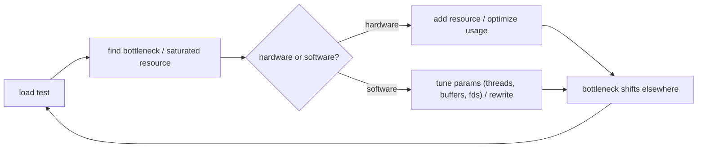

# 21 · Performance Engineering

> **In one line:** a system's throughput is capped by its **bottleneck** (the slowest component); performance
> engineering is an **iterative loop** — load-test → find the saturated resource → optimize it → the bottleneck
> moves → repeat — guided by a few laws (**Little's**, **Amdahl's**, the utilization law) and a toolbox (profilers,
> cache/lock awareness).

Prereqs: [[05 - CPU Scheduling]], [[07 - Locks]], [[13 - Paging]], [[18 - Network IO Sockets]]. Ties together the whole course.

---

## 1. Parameters and metrics

Real systems are **multi-tier** (clients → web servers → app servers → databases), each tier a multi-threaded
program on many cores. To talk about performance, separate **inputs** from **outputs**:

- **Inputs (load):** number of concurrent users/requests, arrival rate (req/s), mix of request types.
- **Outputs (metrics):** **throughput** (req/s served), **response time / latency** (mean and **percentiles** —
  p99 matters), **utilization** of each resource, **error** counts.

**Load testing** = vary the input load, measure the outputs.

## 2. The bottleneck

> **A system's capacity = the throughput of its slowest component.**

Example: front-end 1000 req/s, app server 5000 req/s, **database 100 req/s** → system capacity = **100 req/s**.
The database is the **bottleneck**: it saturates first, while others sit idle. Its **service demand** (time to
process one request, ~10 ms here) sets a floor on response time. (Sometimes the network/a router is the
bottleneck, not a component.)

## 3. What a load test looks like

```
 throughput                         latency
   │        ___________               │                 /
   │      /                           │                /
   │    /   (flattens at capacity)    │      _________/  (rises sharply)
   │  /                               │ ____/
   └────────────── load              └────────────── load
       capacity ↑                         capacity ↑
```
- **Load ≪ capacity:** throughput tracks load, latency low, nothing saturated.
- **Load → capacity:** bottleneck gets busy, queues build, latency rises.
- **Load > capacity:** bottleneck **fully saturated**, throughput **flattens** (can't go higher), latency keeps
  climbing from queueing delay.

**Ideal operating point:** just **below** saturation — near-max throughput, acceptable latency, no errors.

## 4. Improving capacity

At saturation **some resource is 100% utilized**. Find it, then either add more of it or use it more efficiently:

- **Hardware bottleneck** (CPU cores all busy / disk maxed / NIC maxed): add hardware or optimize usage.
- **Software bottleneck** — the tell-tale sign: **throughput flattens but no hardware resource is fully
  utilized.** Causes: hitting the max file-descriptor limit, threads waiting on locks while CPU is free, too few
  threads to keep cores busy, undersized buffers/queues. Fixed by **tuning parameters or rewriting code**, not
  more hardware.

**The workflow:**

Optimize the bottleneck → it improves → **the bottleneck moves somewhere else** → repeat. Performance engineering
is inherently iterative.

## 5. Finding the problem: monitoring + profiling

- **Resource monitors** tell you *which* resource is saturated: `top` (CPU), `free` (memory), `iostat` (disk/IO),
  memory-bandwidth tools.
- **Profilers** (`perf`, `oprofile`) tell you *why*: count hardware events (cache misses) and software events
  (page faults), attribute them to functions, show where CPU time goes. Profiling is the **starting point** for
  optimization — measure before you optimize.

## 6. The three laws

### Little's law: `N = R × W`
In steady state, **number in system = arrival rate × time in system.** Wildly general; use it to **size buffers
and queues**: requests at 100/s, each worker takes 2 s → `N = 100 × 2 = 200`, so you need a buffer of ~200
between master and workers. Too small → requests dropped and idle workers.

### Utilization law → optimal thread-pool size
A worker that does **0.01 s of CPU** work but waits **1 s on I/O** per request uses the CPU only 1% of the time.
**Optimal threads to saturate one core = turnaround time / service demand = 1.01 / 0.01 ≈ 100.** Fewer threads
(say 50) → ~50% CPU utilization and throughput that flattens early. (This is why I/O-bound servers need many
threads per core.)

### Amdahl's law: parallelism has a ceiling
If fraction **α** of a task is parallelizable over **p** cores:
```
T_p = α·T₁/p + (1−α)·T₁          speedup = T₁/T_p
for large p:  speedup → 1/(1−α)
```
The **serial fraction (1−α)** caps the speedup no matter how many cores — e.g. 5% serial ⇒ max 20× ever. Lesson:
**minimize the serial part** (critical sections, locks) for multicore scaling. (Critical sections run one thread
at a time — [[07 - Locks]] — so they're pure serial fraction.)

## 7. CPU, memory, and cache optimization

**CPU:** profile to find hot code; optimize/rewrite or use faster libraries. For kernel CPU: reduce interrupts
(better drivers, spread IRQs across cores — [[19 - Network IO in Linux]]), better filesystems, tune the scheduler
to cut context switches.

**Memory:** avoid thrashing (keep the working set small, improve **locality** — [[14 - Demand Paging]]); **huge
pages** raise TLB hit rates ([[13 - Paging]]); pre-allocate instead of `malloc`; use **custom/slab allocators**
([[12 - Memory System Calls]]); avoid unnecessary copies (`mmap` a file to skip the kernel→user copy).

**Cache (the subtle, high-value part):**
- Keep the working set small enough to fit in cache; improve **locality of reference** (access a matrix
  **row-wise not column-wise**; merge loops over the same array).
- Align hot data to **64-byte cache lines**; group frequently-accessed fields together.
- **Avoid false sharing:** two threads on different cores writing **different** variables that happen to sit on
  the **same cache line** → the line **bounces** between cores via cache coherence, killing performance (vs
  *true* sharing, same address). Put per-thread data on separate cache lines. (This is a core lesson from your
  Micro Exchange project — [[Micro Exchange - prep]].)
- Minimize shared data and **lock contention** (a hot lock's cache line bounces across cores); prefer optimized
  locks / lock-free structures.
- Sequential access beats random (the **prefetcher** predicts strided access and fetches ahead).

## 8. Other levers

- **Compiler optimizations** on; offload to **accelerators** (GPUs) where it fits; **cache** expensive I/O
  results.
- **Scaling:** **vertical** (bigger machine at the bottleneck) vs **horizontal** (more machine replicas).
- **Throughput vs response time:** throughput is set by the **bottleneck's** service demand; response time is the
  **sum across all components** (service demand + queueing). Optimizing a **non-bottleneck** component doesn't
  raise throughput but **does** lower latency. Start at the bottleneck for throughput.

---

## Interview questions

> [!question] Q1. What is a bottleneck and how do you find it?
> The slowest component, which caps system throughput — it saturates (100% of some resource) first while others
> are idle. Find it by load-testing and monitoring each resource (`top`/`free`/`iostat`); the saturated one, or
> the one whose queue grows, is the bottleneck.

> [!question] Q2. What does a throughput-vs-load curve look like and where do you operate?
> Throughput rises with load, then **flattens at capacity** when the bottleneck saturates; latency stays low then
> **rises sharply** past capacity due to queueing. Operate just **below** saturation: near-max throughput,
> acceptable latency, no errors.

> [!question] Q3. State Little's law and use it.
> `N = R × W` (items in system = arrival rate × time in system), in steady state. Use it to size queues/buffers:
> at 100 req/s with 2 s per request, you need ~200 in flight, so a ~200-slot buffer; too small drops requests and
> starves workers.

> [!question] Q4. State Amdahl's law and its lesson.
> With parallel fraction α over p cores, speedup = 1/((1−α) + α/p), approaching **1/(1−α)** as p→∞. The serial
> fraction caps speedup regardless of cores (5% serial ⇒ ≤20×). Minimize serial sections — especially critical
> sections and lock-held regions — for multicore scaling.

> [!question] Q5. How many threads should a thread pool have?
> ≈ turnaround time / service demand per request. If a worker spends 0.01 s on CPU and 1 s waiting on I/O, you
> need ~100 threads to keep one core busy; fewer leaves the CPU under-utilized and throughput flat. I/O-bound work
> wants many threads per core; CPU-bound work wants ~one per core.

> [!question] Q6. What is false sharing and how do you fix it?
> Two threads on different cores modify **different** variables that lie on the **same 64-byte cache line**; cache
> coherence forces the line to bounce between cores on every write, even though there's no real data sharing. Fix
> by padding/aligning so each thread's hot data sits on its own cache line.

> [!question] Q7. If you optimize a non-bottleneck component, what happens to throughput and latency?
> Throughput is unchanged (it's set by the bottleneck's service demand), but **latency improves** (response time
> is the sum over all components). To raise throughput you must optimize the bottleneck — after which the
> bottleneck shifts and you iterate.

> [!question] Q8. How do you tell a software bottleneck from a hardware one?
> Hardware: throughput flattens **and** a resource is 100% utilized (CPU/disk/NIC). Software: throughput flattens
> but **no** resource is saturated — e.g. fd limits, lock contention with idle CPU, too few threads, undersized
> buffers. Software bottlenecks are fixed by tuning/rewriting, not adding hardware.

## Five things to remember
1. **Throughput = the bottleneck's capacity**; the bottleneck is whatever saturates first. Operate just below saturation.
2. Performance engineering is a **loop**: load-test → find saturated resource → optimize → bottleneck shifts → repeat; **profile before optimizing**.
3. **Little's law** `N = R×W` sizes queues; **optimal threads ≈ turnaround/service-demand**; **Amdahl's law** caps speedup at **1/(1−α)**.
4. **Software bottleneck** tell = throughput flat with **no** resource maxed (fd limits, lock contention, too few threads, small buffers).
5. Memory/cache wins: **locality**, **huge pages**, align to **64-byte cache lines**, **avoid false sharing** and lock-line bouncing.
