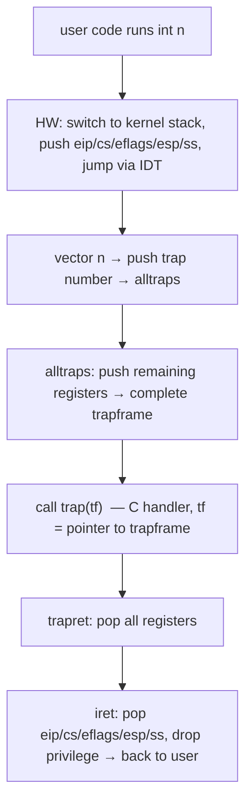

# 26 · xv6 Trap Handling

> **In one line:** every trap in xv6 (syscall, interrupt, fault) runs `int n`, which + the **`alltraps`** assembly
> builds a **trapframe** on the kernel stack and calls the C function **`trap()`**, which dispatches by trap
> number; **`trapret`/`iret`** restore the trapframe and return to user mode.

Prereqs: [[04 - Trap Handling and Context Switching]] (the generic mechanism), [[22 - xv6 Introduction]] (x86). Next: [[27 - xv6 Switch]].

---

## 1. What causes a trap

The same three events as [[04 - Trap Handling and Context Switching]]: **system call**, **interrupt**, **program
fault**. All cause the CPU to run **`int n`**, where `n` indexes the **IDT** to find the kernel handler:
- syscalls use `n = T_SYSCALL` (invoked from `usys.S` — [[25 - xv6 Process System Calls]]);
- hardware devices cause the CPU to run `int` with their IRQ number.

## 2. The trapframe

The **trapframe** is the saved register state pushed on the **kernel stack** on entry, popped on return. It's
built in two steps:
1. The **`int n` hardware** pushes a few registers automatically: the old **`eip`** (user PC), **`cs`**,
   **eflags**, and (on a privilege change) the old **`esp`/`ss`**.
2. The kernel's **`alltraps`** assembly pushes the **remaining** registers to complete the trapframe.

> [!question] Why does the hardware push `eip`/`esp`, not the kernel code?
> Because at the instant of the trap the CPU is switching privilege level and stacks — the user PC and SP must be
> saved **by the CPU itself** before any kernel instruction runs, otherwise they'd already be overwritten. The
> kernel can only run *after* it's safely in kernel mode on the kernel stack, so it fills in the rest.

## 3. The flow: `int` → `alltraps` → `trap()` → `trapret` → `iret`



- All IDT entries funnel to **`alltraps`**, which completes the trapframe and calls the C function **`trap(tf)`**,
  passing a pointer to the trapframe (the current top of stack).
- On the way back, **`trapret`** pops all the saved registers and **`iret`** (the "return-from-trap" instruction,
  the inverse of `int`) pops what `int` pushed and drops back to user mode.

## 4. The C dispatcher `trap()`

```c
void trap(struct trapframe *tf) {
  if (tf->trapno == T_SYSCALL) { ... syscall(); return; }   // → dispatch on eax ([[25 - xv6 Process System Calls]])
  switch (tf->trapno) {
    case T_IRQ0 + IRQ_TIMER: ... ; break;      // timer: see below
    case T_IRQ0 + IRQ_IDE:   ideintr(); break; // disk interrupt → driver
    // ... other device interrupts → their drivers
    default: // program fault → kill the process (or panic if in kernel)
  }
  // if this was the timer and the process has run long enough → yield()
  if (myproc() && tf->trapno == T_IRQ0+IRQ_TIMER) yield();
}
```
- **Syscall** → `syscall()`, which reads `eax` and calls the right kernel function.
- **Device interrupt** → the device's driver (e.g. disk).
- **Program fault** → terminate the offending process.
- **Timer interrupt** is special: after handling it, the process **`yield()`s** the CPU to the scheduler — this is
  how xv6 does **preemptive** round-robin scheduling ([[05 - CPU Scheduling]], [[27 - xv6 Switch]]).

## 5. The complete story (one breath)

`int n` switches ESP to the **kernel stack** and EIP to **`alltraps`** (via the IDT), the hardware + `alltraps`
save the pre-trap state in the **trapframe**, `alltraps` calls the C **`trap()`** which handles it by trap number,
then **`trapret`** + **`iret`** restore the trapframe and return to user mode — exactly the generic flow of
[[04 - Trap Handling and Context Switching]], made concrete.

---

## Interview questions

> [!question] Q1. Walk through a trap in xv6 from `int n` to returning to user mode.
> `int n` (hardware) switches to the kernel stack, pushes eip/cs/eflags/(esp/ss), and jumps via the IDT to the
> vector, which pushes the trap number and goes to `alltraps`. `alltraps` pushes the remaining registers
> (completing the trapframe) and calls C `trap(tf)`, which dispatches on the trap number. On return, `trapret`
> pops the registers and `iret` pops what `int` pushed and returns to user mode.

> [!question] Q2. Why are some registers pushed by hardware and the rest by `alltraps`?
> The CPU must save the user `eip`/`esp` (and switch stacks/privilege) **atomically at the trap** — before any
> kernel instruction runs — or they'd be lost. Only once safely in kernel mode on the kernel stack can software
> (`alltraps`) save the remaining general registers to finish the trapframe.

> [!question] Q3. How does xv6 dispatch different kinds of traps?
> `trap(tf)` checks `tf->trapno`: `T_SYSCALL` → `syscall()` (dispatches on `eax`); a device IRQ → that device's
> driver; a program fault → kill the process. All IDT vectors funnel through `alltraps` into this one C function.

> [!question] Q4. How does the timer interrupt lead to preemptive scheduling in xv6?
> On a timer interrupt, `trap()` handles it and then calls `yield()`, which makes the process give up the CPU to
> the scheduler (via `sched`/`swtch`). The periodic timer thus forces round-robin preemption even if the process
> never makes a syscall ([[05 - CPU Scheduling]]).

> [!question] Q5. What is `iret` and how does it relate to `int`?
> `iret` is the return-from-trap instruction, the inverse of `int`: it pops the eip/cs/eflags/(esp/ss) that `int`
> pushed, restores the privilege level, and resumes user execution where the trap occurred.

## Five things to remember
1. All traps (syscall/interrupt/fault) run **`int n`**; `n` indexes the **IDT** to the handler.
2. The **trapframe** (saved registers on the kernel stack) is built by **hardware (eip/cs/eflags/esp/ss)** + **`alltraps`** (the rest).
3. All vectors funnel through **`alltraps` → C `trap(tf)`**, which dispatches by **trap number** (syscall / device driver / fault).
4. Return path: **`trapret` → `iret`** restores the trapframe and drops to user mode (`iret` is the inverse of `int`).
5. On a **timer** interrupt `trap()` calls **`yield()`** → preemptive round-robin scheduling.
