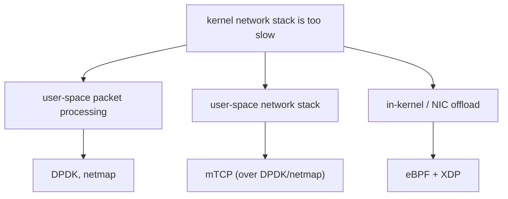

# 31 · Network Stack and Kernel Bypass

> **In one line:** the full kernel packet path (NIC→driver→L2→L3→L4→socket→copy) is too slow for 40/100 Gbps
> because of interrupts, `sk_buff` allocation, kernel↔user copies, context switches, and shared structures — so
> high-speed systems **bypass** it with **poll-mode user-space drivers** (DPDK, netmap), **user-space TCP
> stacks** (mTCP), or **in-kernel offload** (eBPF/XDP).

Prereqs: [[19 - Network IO in Linux]], [[18 - Network IO Sockets]], [[15 - IO Devices]]. Implementation companion: [[30 - DPDK Deep Dive]].

---

## 1. The full journey of a packet (RX, in detail)

A received packet climbs the layers; each adds work ([[19 - Network IO in Linux]] gives the summary — here's the
full stack):

```
      RX path                         packet layout
 ┌──────────────┐          ┌──────┬──────┬───────┬─────────┬─────┐
 │ Application   │ copy     │ Eth  │  IP  │  TCP  │ payload │ FCS │
 ├──────────────┤ ↑        └──────┴──────┴───────┴─────────┴─────┘
 │ Transport L4 │          (dst MAC / src,dst IP / src,dst port / checksums)
 ├──────────────┤
 │ Network   L3 │
 ├──────────────┤
 │ Data link L2 │
 ├──────────────┤
 │ NIC driver   │
 ├──────────────┤
 │ NIC hardware │ ← DMA into RX ring, raise interrupt
 └──────────────┘
```

1. **NIC**: matches dst MAC, verifies Ethernet checksum (FCS), **DMAs** the packet into an RX ring buffer, raises
   an **interrupt**.
2. **Top half** (minimal): look up the IDT, run the ISR — ack the interrupt, **schedule the bottom half**.
3. **Bottom half** (softirq, when CPU is free): **allocate an `sk_buff`**, fill in packet metadata, strip the
   Ethernet header, pass up to L3.
4. **L3 (IP)**: route lookup, reassemble fragments, verify/strip header, call L4.
5. **L4 (TCP)**: match the socket, handle the TCP state machine, verify checksum, **enqueue to the socket's
   receive queue**, signal the socket.
6. **Application**: on `read`, **copy** the payload from the kernel buffer to the user buffer (another mode
   switch), release the `sk_buff`.

(TX is the mirror image: `write` → copy to kernel, L4 builds TCP header, L3 builds/fragments IP, L2 enqueues to
the **qdisc** for scheduling, NIC computes FCS, DMAs, and interrupts "sent.")

## 2. Why the kernel path is too slow

At 40/100 Gbps with small packets, per-packet overhead dominates — you **can't reach line rate**:
- **Per-packet interrupts** (interrupt storm).
- **Dynamic `sk_buff` allocation** per packet.
- **Copy** between kernel and user space.
- **Context switches** (app ↔ softirq, user ↔ kernel) — which also **pollute the CPU cache** ([[21 - Performance]]).
- **Shared data structures** (socket/TCP state) contended across cores.

**In-kernel optimizations** that help but don't fully solve it: **NAPI** (interrupt→poll hybrid,
[[19 - Network IO in Linux]]), **GRO/GSO** (batch many packets into one large pseudo-packet to traverse the stack
once), and **multi-queue NICs + RSS** (spread flows across cores by a 5-tuple hash). When these aren't enough,
bypass the kernel.

## 3. Interrupt vs poll — the core idea behind bypass

| Interrupt mode | Poll mode |
|---|---|
| NIC signals when it needs servicing (hardware) | CPU keeps checking the NIC (via a command-ready bit) |
| Low CPU use at low load; **interrupt overhead at high load** | Burns CPU cycles, but **handles high-speed traffic** without interrupt overhead |

All kernel-bypass frameworks are fundamentally **poll mode** ([[15 - IO Devices]] §3's "polling can beat
interrupts for fast devices").

## 4. The three bypass strategies



### (a) User-space packet processing — DPDK & netmap
Move packet I/O out of the kernel entirely.
- **DPDK** ([[30 - DPDK Deep Dive]]): poll-mode user-space driver **unbinds the NIC from the kernel**; packets go
  into **hugepage** mempools as `rte_mbuf`s via lockless `rte_ring`s; no copy, no `sk_buff`, no interrupts. (Uses
  cooperative multiprocessing — trusted apps only.)
- **netmap**: packet ring buffers are in kernel memory but **mapped shared** with the app (no extra copy); the
  NIC can run netmap *and* normal kernel drivers (transparent mode). Both DPDK and netmap handle up to **L2**;
  L3-L7 is your problem.

### (b) User-space network stack — mTCP
Bypassing gives you raw packets but **no TCP**. A user-space TCP stack provides it:
- **mTCP** runs on top of DPDK/netmap, designed for **multicore scalability**: **per-core** TCP data structures
  (accept queues, socket lists) that are **lock-free**, using the NIC's multi-queue/RSS so each core owns its
  flows (connection locality). It avoids the kernel's **shared** socket/TCP structures that bottleneck under load.

### (c) In-kernel / NIC offload — eBPF & XDP
Instead of leaving the kernel, push your logic **into** it ([[19 - Network IO in Linux]] §5b):
- **eBPF** = safe, sandboxed bytecode run at kernel hook points; made safe/fast by **clang/llvm** compile →
  **`bpf()`** load → **verifier** (proves safety: bounded loops, no bad memory) → **JIT** to native code.
- **XDP** = the hook **in the NIC driver**, run on each packet during NAPI polling, **before** any `sk_buff` or
  copy. Verdicts: `XDP_DROP` (e.g. DDoS filter), `XDP_TX` (bounce back), `XDP_PASS` (up the normal stack),
  `XDP_REDIRECT` (e.g. to an **AF_XDP** socket for user-space processing). Uses: fast firewalls, load balancers,
  KV stores.
- The partner **AF_XDP** socket receives packets straight from XDP into user space with no stack/copy — a
  *cooperative* bypass that still lets the kernel keep control.

> **DPDK vs XDP in one line:** DPDK = *leave* the kernel entirely (max speed, lose tooling/coexistence); XDP = run
> *inside* the kernel (fast, cooperative, keeps kernel tooling and the normal stack for other traffic).

## 5. What's trending (offload spectrum)

Push processing progressively closer to the wire:
- **Into the kernel**: BPF/eBPF/XDP.
- **Into the NIC driver**: XDP at the driver.
- **Into programmable hardware**: SmartNICs/DPUs (Netronome, BlueField, Pensando), FPGAs (Xilinx/Altera),
  programmable ASICs (Barefoot Tofino). The theme from [[21 - Performance]]: when the CPU is the bottleneck,
  offload to specialized hardware.

---

## Interview questions

> [!question] Q1. Trace a packet up the Linux kernel network stack on receive.
> NIC matches dst MAC, verifies FCS, DMAs into the RX ring, interrupts. Top half acks + schedules the bottom half;
> the bottom half (softirq) allocates an `sk_buff`, strips the Ethernet header, and passes it to L3 (route lookup,
> reassembly) then L4 (TCP state machine, checksum, enqueue to the socket). On `read`, the payload is copied to
> the user buffer and the `sk_buff` freed.

> [!question] Q2. Why can't the kernel stack hit 100 Gbps, and what in-kernel optimizations help?
> Per-packet interrupts, `sk_buff` allocation, kernel↔user copies, context switches (cache pollution), and
> contended shared structures dominate at small-packet line rate. In-kernel helpers: **NAPI** (interrupt→poll),
> **GRO/GSO** (batch packets through the stack once), and **multi-queue + RSS** (spread flows across cores). Past
> that, you bypass the kernel.

> [!question] Q3. What are the main kernel-bypass approaches?
> (1) **User-space packet I/O**: DPDK (poll-mode driver, unbind NIC, hugepage mbufs, no copy) and netmap (shared
> rings). (2) **User-space TCP stack**: mTCP (per-core lock-free TCP over DPDK/netmap). (3) **In-kernel/NIC
> offload**: eBPF/XDP (verified JIT'd code at the driver hook). Plus SmartNIC/FPGA/ASIC offload.

> [!question] Q4. DPDK vs XDP — when would you pick each?
> DPDK fully bypasses the kernel for maximum throughput but dedicates a core to polling and loses kernel tooling
> and coexistence — good for a dedicated packet-processing appliance. XDP runs verified code inside the NIC driver
> before `sk_buff`, so it's fast **and** cooperative (other traffic still uses the kernel stack, tooling still
> works) — good for in-kernel firewalls/load balancers that must share the host.

> [!question] Q5. Why does bypassing the kernel force you to add something like mTCP?
> Bypass frameworks (DPDK/netmap) only deliver raw L2 packets — you lose the kernel's TCP/IP implementation. To
> speak TCP you need a user-space stack; mTCP provides one built for multicore with per-core, lock-free TCP state
> to avoid the kernel's contended shared socket structures.

> [!question] Q6. How is eBPF made safe and fast enough to run in the kernel?
> Source is compiled (clang/llvm) to eBPF bytecode and loaded via `bpf()`. A **verifier** statically proves it's
> safe (no unbounded loops, no out-of-bounds memory, bounded stack) before it runs, and a **JIT** compiles it to
> native code for speed. This lets untrusted user logic run in kernel context without crashing or hanging it.

## Five things to remember
1. Full RX path: **NIC→DMA→interrupt→top/bottom half→sk_buff→L3/L4→socket→copy to user**; TX is the mirror (+ qdisc).
2. Kernel-stack overheads (interrupts, `sk_buff` alloc, copies, context switches, shared structures) cap it below 40/100 Gbps.
3. In-kernel speedups: **NAPI** (interrupt→poll), **GRO/GSO** (batch through the stack once), **multi-queue + RSS**.
4. Bypass strategies: **DPDK/netmap** (user-space poll-mode I/O), **mTCP** (user-space per-core TCP), **eBPF/XDP** (in-kernel offload before sk_buff).
5. **DPDK = leave the kernel** (max speed, lose tooling); **XDP = inside the kernel** (fast, cooperative); offload trend continues to **SmartNICs/FPGAs/ASICs**.
